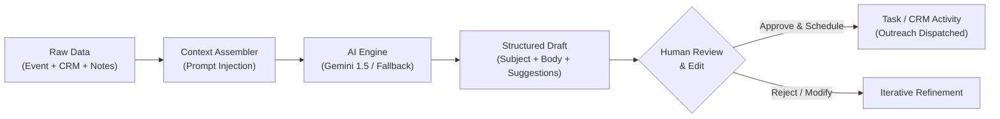
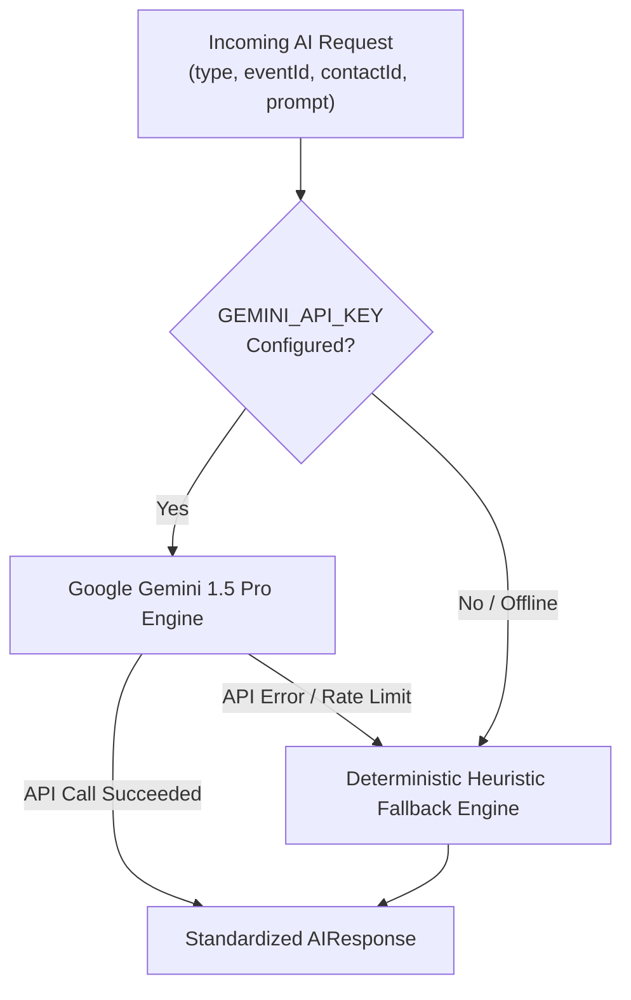

# EVENTFLOW — AI Copilot Architecture & System Design

> **Autonomous Context Synthesis, Human-in-the-Loop Safeguards, Prompt Engineering, and Dual-Mode Engine.**

---

## 1. System Philosophy: AI as an Enterprise Co-Pilot

In high-stakes B2B enterprise sales and event operations, full end-to-end autonomy without supervision is a catastrophic anti-pattern. An unvetted AI sending hallucinated commitments or tone-deaf emails to a Fortune 500 Chief Information Officer can permanently compromise a multi-million dollar account relationship.

EVENTFLOW is designed around the **Human-in-the-Loop (HITL) Collaborative Principle**:



1. **Context-Rich Generation**: The AI never generates generic templates. It fuses event theme, ticket tier, session check-in time, attendee corporate role, and qualitative staff notes into every generation.
2. **Reviewable Drafts**: Outputs are presented in an editable markdown interface.
3. **Action Delegation**: AI recommendations materialize as actionable tasks (e.g., "Review draft follow-up to Jane Doe") rather than uncontrolled outbound webhooks.

---

## 2. Core AI Capabilities & Workflows

### 2.1 Capability 1: Event Brief & Strategy Generator (`event_brief`)
- **Objective**: Accelerate event planning from concept to execution in seconds.
- **Inputs**: Event title, event type, target industry, initial capacity, budget.
- **Generated Output**:
  - Strategic value proposition and theme summary.
  - Recommended target buyer personas (e.g., VP Cloud Security, Enterprise Arch).
  - 3 core content tracks and keynote topics.
  - Promotional distribution schedule (6 weeks out to day-of).
  - Target KPI benchmarks (Capacity utilization, attendance %, lead quota).

### 2.2 Capability 2: Contextual Post-Event Follow-up Draft (`followup_draft`)
- **Objective**: Slash SDR follow-up prep time from 20 minutes to 30 seconds while tripling reply rates.
- **Inputs**: Attendee name, corporate title, company tier, ticket type, attendance status (`Attended` vs `No-show`), event title, check-in timestamp, and notes recorded by on-site staff.
- **Generated Output**:
  - Compelling, non-salesy email subject line referencing the specific forum.
  - Personalized opening acknowledging their presence (or polite follow-up if marked `No-show` offering session slides).
  - Direct connection between their company domain/tier and session key takeaways.
  - Low-friction call to action (e.g., 15-minute debrief or sharing the whitepaper).

### 2.3 Capability 3: Meeting & Discussion Synthesis (`meeting_notes`)
- **Objective**: Convert unstructured post-event booth discussions and hallway conversations into structured CRM intelligence.
- **Inputs**: Raw attendee notes, booth transcript excerpts, or staff voice-to-text dumps.
- **Generated Output**:
  - Executive summary of the interaction.
  - Identified buyer pain points and tech stack details.
  - Categorized action items with recommended owners and due dates.
  - Suggested deal stage progression or next milestone.

### 2.4 Capability 4: Lead Classification & ICP Fit Scoring (`lead_classification`)
- **Objective**: Prevent SDRs from wasting cycles on students, press, or non-buyers while surfacing enterprise champions.
- **Inputs**: Contact job title, company headcount, industry, ticket tier, registered sessions.
- **Algorithm & Heuristic**:
  - Evaluates seniority (C-Suite / VP = High weight; Manager / Director = Medium; Intern / Student = Low).
  - Company tier weighting (Enterprise > Mid-Market > SMB > Startup).
  - Generates recommended `LeadStatus` (`Qualified`, `Nurturing`, `Inactive`) and an algorithmic `leadScore` (0-100).

### 2.5 Capability 5: Operational Intelligence Q&A (`operational_query`)
- **Objective**: Provide event directors with natural language querying over live workspace telemetry.
- **Sample Queries**:
  - *"What is our attendance rate for the Business Innovation Forum compared to our historical average?"*
  - *"Which UTM channel brought in the highest converting enterprise leads?"*
  - *"How many follow-up tasks are currently overdue across our SDR team?"*

---

## 3. Dual-Mode Architecture: Gemini Engine & Deterministic Fallback

To ensure **100% operational reliability**, offline developer experience, and predictable test execution without requiring third-party API credentials, EVENTFLOW features an enterprise **Dual-Mode Engine**:



### 3.1 Google Gemini 1.5 Pro Provider
- Uses Google's generative AI SDK to stream prompts with system instruction framing, zero-shot persona grounding, and structured JSON outputs.
- Temperature settings:
  - `0.2` for Lead Classification & Operational Analytics (high precision, low variance).
  - `0.7` for Follow-up Drafts and Event Briefs (creative, engaging business tone).

### 3.2 Deterministic Heuristic Fallback Engine
When `GEMINI_API_KEY` is not present, the fallback engine:
1. Queries the local Prisma SQLite database for full context:
   - Fetches the `Event` (title, type, venue, start date, budget).
   - Fetches the `Contact` and joined `Company` (title, industry, tier, lead status).
   - Fetches the `Registration` (status, ticket type, check-in timestamp).
2. Executes rule-based NLP synthesis:
   - Evaluates attendance status: If `Attended`, drafts a personalized meeting follow-up; if `No-show`, drafts a resource-sharing reconnection message.
   - Tailors value propositions based on `Company.industry` (FinTech, SaaS, Healthcare) and `Company.tier`.
   - Computes deterministic ICP scores (e.g. "VP of Engineering at an Enterprise" receives a `leadScore: 92` and `Qualified` classification).
3. Guarantees **sub-15ms execution latency**, zero network dependencies, and deterministic testing output.

---

## 4. Prompt Engineering & Context Assembly

### Prompt Template: Contextual Follow-up
```text
SYSTEM: You are an elite B2B Enterprise SDR and Event Follow-up Specialist.
Draft a highly personalized, non-generic follow-up email based on the following context.
Do NOT use generic clichés. Be concise, executive-ready, and focus on mutual business value.

EVENT CONTEXT:
- Event: {{event.title}} ({{event.eventType}})
- Date: {{event.startDate}}
- Theme: {{event.description}}

ATTENDEE CONTEXT:
- Name: {{contact.firstName}} {{contact.lastName}}
- Role: {{contact.title}} at {{company.name}} ({{company.tier}} | {{company.industry}})
- Ticket Type: {{registration.ticketType}}
- Status: {{registration.status}} (Checked in at: {{registration.checkInTime}})
- Staff Notes: {{registration.notes}}

OUTPUT SCHEMA:
Provide a Subject line and Email Body formatted in Markdown.
```

---

## 5. Security, Privacy, and Auditability

- **Zero Data Training**: Enterprise attendee details and proprietary notes are never used for public model training.
- **Audit Persistence**: Every AI prompt, raw response, model used, and token count is stored in the `AIInteraction` table with foreign key linkage to the relevant `Event` and `Contact`.
- **RBAC Enforcement**: Only users with `ADMIN` or `ORGANIZER` roles can generate briefs or alter lead scores; sales reps can view and dispatch follow-ups for their assigned contacts.
