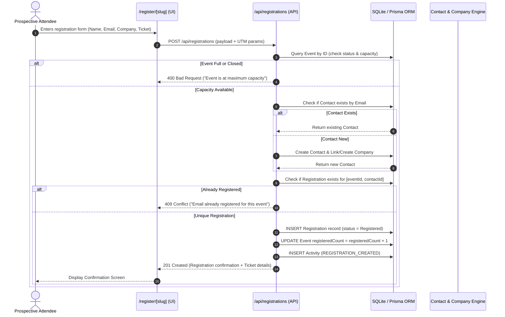
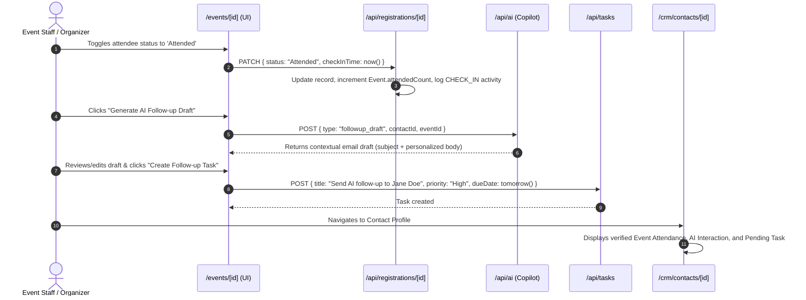

# EVENTFLOW — System Architecture & Technical Design

> **Technical Architecture, Data Flows, Component Hierarchy, and Service Design for EVENTFLOW.**

---

## 1. High-Level System Architecture

EVENTFLOW is architected as a modern, reactive B2B Event-Led CRM application utilizing Next.js 14+ (App Router), TypeScript, Prisma ORM, and SQLite. The system is decomposed into four cohesive tiers:

```mermaid
graph TD
    subgraph Presentation_Layer["Presentation Tier (Client / Server Components)"]
        UI_Dash["Executive Dashboard\n(/)"]
        UI_Events["Event Workspace\n(/events, /events/[id])"]
        UI_Reg["Public Portal\n(/register/[slug])"]
        UI_CRM["CRM Directory & Profile\n(/crm, /crm/contacts/[id])"]
        UI_Pipe["Sales Pipeline Kanban\n(/crm/pipeline)"]
        UI_Tasks["Task Queue\n(/tasks)"]
        UI_Analytics["BI Analytics\n(/analytics)"]
        UI_AI["AI Copilot Suite\n(/ai)"]
    end

    subgraph API_Layer["API Route Handlers (src/app/api/)"]
        API_Events["/api/events\n/api/events/[id]"]
        API_Reg["/api/registrations\n/api/registrations/[id]"]
        API_CRM["/api/contacts\n/api/companies\n/api/opportunities"]
        API_Tasks["/api/tasks"]
        API_Analytics["/api/analytics"]
        API_AI["/api/ai"]
        API_Seed["/api/seed"]
    end

    subgraph Domain_Services["Domain Services (src/lib/)"]
        SVC_Reg["Registration Engine\n(Capacity, Duplicates, Auto-CRM)"]
        SVC_CRM["CRM & Pipeline Engine\n(Account Matching, Stage Moves)"]
        SVC_AI["AI Copilot Engine\n(Gemini 1.5 Pro + Deterministic Fallback)"]
        SVC_Analytics["BI Analytics Engine\n(KPIs, Trends, Attribution Funnel)"]
        SVC_Activity["Activity Audit Stream\n(Audit Trail & Timeline Ingestion)"]
    end

    subgraph Persistence_Layer["Data & Persistence Tier"]
        DB_Prisma["Prisma ORM Client Singleton\n(src/lib/db.ts)"]
        DB_SQLite["SQLite Relational DB\n(prisma/dev.db)"]
    end

    Presentation_Layer -->|HTTP / React Fetch| API_Layer
    API_Layer --> Domain_Services
    Domain_Services --> DB_Prisma
    DB_Prisma --> DB_SQLite
```

---

## 2. Architectural Layers

### 2.1 Presentation Tier
The frontend is constructed using the Next.js App Router with React Server Components (RSC) and interactive Client Components (`'use client'`).

- **Design System & Theme**:
  - Main background: `#090D14` (Deep obsidian)
  - Secondary background: `#101722` (Dark charcoal)
  - Card & Container background: `#131C29` (Subtle midnight navy)
  - Elevated surfaces: `#192435`
  - Primary Accent Blue: `#3987F5` / Secondary: `#2563EB`
  - Success Green: `#35B982` | Warning Amber: `#E8B45E` | Error Red: `#E36C75`
  - Typography: Crisp Inter/Geist-sans aesthetic with high-contrast text (`#EAF0F8` primary, `#91A0B5` secondary).
- **Navigation & Layout Structure**:
  - Fixed responsive left sidebar housing platform navigation with active route indicators and workspace switcher.
  - Contextual top bar with global search, notifications indicator, and quick-action trigger modal.
  - Zero non-functional decorative controls: all buttons, dropdowns, and tabs trigger live state or API mutations.

### 2.2 API & Routing Tier (`src/app/api/`)
The backend is implemented as standardized Next.js Route Handlers exposing JSON REST endpoints:

| Endpoint | Methods | Responsibility |
| :--- | :--- | :--- |
| `/api/events` | `GET`, `POST` | List events with filtering/search; create new event with capacity & dates. |
| `/api/events/[id]` | `GET`, `PUT`, `DELETE` | Retrieve detailed event workspace data; update event config; cascade delete. |
| `/api/registrations` | `GET`, `POST` | Query registrations; public registration ingestion with deduplication & CRM upsert. |
| `/api/registrations/[id]` | `PATCH` | Update registration status (`Registered` → `Confirmed` → `Attended` → `No-show`). |
| `/api/contacts` | `GET`, `POST` | Paginated CRM contact directory with search by name, email, company, or status. |
| `/api/contacts/[id]` | `GET`, `PATCH` | Contact 360° record with events attended, tasks, deals, and activity feed. |
| `/api/companies` | `GET`, `POST` | Corporate account directory with industry, headcount tier, and aggregate pipeline. |
| `/api/opportunities` | `GET`, `POST`, `PATCH` | Sales pipeline management with stage transitions and deal value calculation. |
| `/api/tasks` | `GET`, `POST`, `PATCH` | Follow-up task tracking by assignee, priority, status, contact, and event. |
| `/api/analytics` | `GET` | Closed-loop BI calculations: 8 KPIs, trend series, funnels, and UTM attribution. |
| `/api/ai` | `POST` | AI assistant dispatcher: event briefs, follow-up drafts, meeting notes, lead classification. |
| `/api/seed` | `POST` | Dynamic database reset and synthetic enterprise data generation. |

### 2.3 Domain Services Layer (`src/lib/`)
Encapsulates reusable enterprise business rules across API endpoints:

1. **Registration & CRM Linkage Engine**:
   - Validates email formatting and ensures mandatory attendee fields exist.
   - Enforces unique constraint: `[eventId, contactId]` preventing duplicate registrations.
   - Performs atomic capacity checking: rejects registration if `registeredCount >= capacity`.
   - Automatically checks if a `Contact` exists by email. If not, creates the contact and matches/creates the associated `Company` via domain parsing or user input.
   - Increments `Event.registeredCount` atomically.
   - Dispatches a `REGISTRATION_CREATED` entry to the `Activity` log.
2. **AI Engine (`src/lib/ai-service.ts`)**:
   - Manages prompts and contextual injections across 5 specific B2B event AI workflows.
   - Integrates with Google Gemini API when `GEMINI_API_KEY` is present.
   - Employs an intelligent **Deterministic Heuristic Fallback Engine** when offline or in test environments, guaranteeing deterministic responses matching domain schemas.
3. **Analytics & Aggregation Engine**:
   - Computes weighted pipeline attribution, attendance ratios, and conversion drop-offs across registration lifecycle stages.

### 2.4 Persistence Tier
- **Prisma Client Singleton**: Located in `src/lib/db.ts` to prevent client connection exhaustion across Next.js serverless and hot-reload invocations.
- **Relational Integrity**: Foreign key constraints and cascade rules guarantee referential consistency between workspaces, events, registrations, contacts, companies, tasks, and activities.
- **SQLite Database (`prisma/dev.db`)**: Provides zero-dependency, atomic, high-performance local execution with strict SQL compliance.

---

## 3. End-to-End Data Flows

### 3.1 Public Registration to CRM Ingestion Flow

### 3.2 Attendance Check-in to Lead Follow-up Lifecycle

---

## 4. Key Design Patterns

1. **Singleton Database Connection**:
   Uses the global namespace pattern in `src/lib/db.ts` to ensure only one instance of `PrismaClient` is instantiated during Next.js hot module replacement (HMR).
2. **Deterministic Graceful Degradation**:
   The AI engine is architected with dual-pipeline execution: if external LLM credentials fail or are absent, the system seamlessly transitions to domain-tailored heuristics without throwing uncaught exceptions.
3. **Optimistic & Defensive State Management**:
   Client UI components feature defensive rendering, ensuring loading states, empty states, and mutation errors are rendered gracefully with zero layout shifts.
4. **Audit Trail Immutability**:
   All state changes (registration, attendance toggles, pipeline moves) create immutable `Activity` records, providing a complete historical ledger of attendee engagements.
