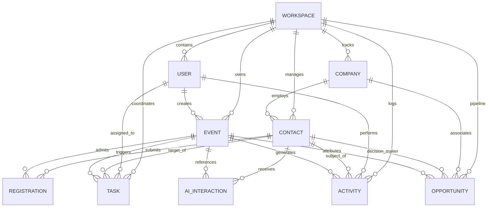

# EVENTFLOW — Data Model & Entity Specifications

> **Comprehensive Relational Schema, Entity Relationships, Constraints, and Enums.**

---

## 1. Entity Relationship Diagram (ERD)

---

## 2. Domain Enums and Allowed Values

### 2.1 Event Enums
- **EventStatus**: `'Draft'` | `'Published'` | `'Completed'` | `'Cancelled'`
- **EventType**: `'Conference'` | `'Webinar'` | `'Workshop'` | `'Networking'` | `'Summit'` | `'Hybrid'`

### 2.2 Registration Enums
- **RegistrationStatus**: `'Registered'` | `'Confirmed'` | `'Attended'` | `'No-show'` | `'Cancelled'`
- **TicketType**: `'General'` | `'VIP'` | `'Speaker'` | `'Sponsor'` | `'Press'`

### 2.3 CRM & Lead Enums
- **LeadStatus**: `'New'` | `'Contacted'` | `'Qualified'` | `'Nurturing'` | `'Customer'` | `'Inactive'`
- **CompanyTier**: `'Enterprise'` | `'Mid-Market'` | `'SMB'` | `'Startup'`
- **CompanySize**: `'1-10'` | `'11-50'` | `'51-200'` | `'201-500'` | `'500+'`

### 2.4 Task & Pipeline Enums
- **TaskPriority**: `'Low'` | `'Medium'` | `'High'` | `'Urgent'`
- **TaskStatus**: `'Pending'` | `'In_Progress'` | `'Completed'` | `'Cancelled'`
- **OpportunityStage**: `'Discovery'` | `'Qualified'` | `'Proposal'` | `'Negotiation'` | `'Won'` | `'Lost'`

### 2.5 Activity & AI Enums
- **ActivityType**:
  - `REGISTRATION_CREATED`: Registration record initialized
  - `STATUS_CHANGED`: Registration or attendee status modified
  - `CHECK_IN`: On-site or virtual check-in executed
  - `NOTE_ADDED`: Qualitative observation added to attendee
  - `TASK_COMPLETED`: Follow-up task marked done
  - `OPPORTUNITY_STAGE_CHANGED`: Deal moved along sales pipeline
  - `EMAIL_SENT`: Follow-up communication dispatched
  - `MEETING_LOGGED`: Sales or discovery call recorded
  - `AI_INSIGHT_GENERATED`: AI Copilot action executed
- **AITaskType**:
  - `event_brief`: Strategic summary and event goals
  - `followup_draft`: Contextual post-event outreach email
  - `meeting_notes`: Synthesis of conversation and next steps
  - `lead_classification`: ICP score and qualification rating
  - `operational_query`: Natural language analytics answers

---

## 3. Relational Entity Specifications

### 3.1 `Workspace`
The root multi-tenant isolation boundary for organizations using EVENTFLOW.

| Field | Type | Attributes | Description |
| :--- | :--- | :--- | :--- |
| `id` | `String` | `@id @default(cuid())` | Unique workspace identifier |
| `name` | `String` | Non-null | Name of the organization |
| `slug` | `String` | `@unique` | URL-safe workspace slug |
| `domain` | `String?` | Nullable | Primary enterprise domain |
| `createdAt`| `DateTime` | `@default(now())` | Timestamp of creation |
| `updatedAt`| `DateTime` | `@updatedAt` | Timestamp of last modification |

---

### 3.2 `User`
Authorized team members, organizers, and sales development reps.

| Field | Type | Attributes | Description |
| :--- | :--- | :--- | :--- |
| `id` | `String` | `@id @default(cuid())` | Unique user identifier |
| `name` | `String` | Non-null | Full name |
| `email` | `String` | `@unique` | Corporate email address |
| `role` | `String` | `@default("ORGANIZER")` | `ADMIN`, `ORGANIZER`, `STAFF`, `VIEWER` |
| `avatarUrl` | `String?` | Nullable | Profile avatar image link |
| `workspaceId` | `String` | Foreign Key | References `Workspace.id` (Cascade) |
| `createdAt` | `DateTime` | `@default(now())` | Creation timestamp |
| `updatedAt` | `DateTime` | `@updatedAt` | Update timestamp |

---

### 3.3 `Event`
The core B2B event record managing logistics, capacity, and attribution.

| Field | Type | Attributes | Description |
| :--- | :--- | :--- | :--- |
| `id` | `String` | `@id @default(cuid())` | Unique event identifier |
| `title` | `String` | Non-null | Full event title |
| `slug` | `String` | `@unique` | Public landing page slug (`/register/[slug]`) |
| `description` | `String` | Non-null | Full markdown event description |
| `shortDescription` | `String?` | Nullable | Executive summary / subtitle |
| `eventType` | `String` | `@default("Conference")` | Conference, Webinar, Workshop, Summit, Hybrid |
| `status` | `String` | `@default("Draft")` | Draft, Published, Completed, Cancelled |
| `startDate` | `DateTime` | Non-null | Scheduled start date & time |
| `endDate` | `DateTime` | Non-null | Scheduled end date & time |
| `timezone` | `String` | `@default("America/New_York")` | Timezone string |
| `location` | `String?` | Nullable | Venue name or virtual platform |
| `venueAddress` | `String?` | Nullable | Physical street address |
| `virtualUrl` | `String?` | Nullable | Video stream or webinar join link |
| `capacity` | `Int` | `@default(100)` | Maximum allowed attendees |
| `registeredCount`| `Int` | `@default(0)` | Counter of total registrations |
| `attendedCount` | `Int` | `@default(0)` | Counter of attendees checked in |
| `bannerUrl` | `String?` | Nullable | Header marketing visual |
| `tags` | `String` | `@default("[]")` | Serialized JSON array of tags |
| `budget` | `Float` | `@default(0.0)` | Total operational marketing budget ($) |
| `expectedRevenue`| `Float` | `@default(0.0)` | Target pipeline attribution ($) |
| `workspaceId` | `String` | Foreign Key | References `Workspace.id` (Cascade) |
| `createdById` | `String?`| Foreign Key | References `User.id` (SetNull) |

---

### 3.4 `Company`
B2B corporate accounts mapped to attendees and sales pipeline deals.

| Field | Type | Attributes | Description |
| :--- | :--- | :--- | :--- |
| `id` | `String` | `@id @default(cuid())` | Unique company identifier |
| `name` | `String` | Non-null | Corporate account legal name |
| `domain` | `String?` | Nullable | Corporate domain (e.g. `acme.corp`) |
| `industry` | `String` | `@default("Technology")` | Industry vertical (SaaS, FinTech, Health) |
| `size` | `String` | `@default("51-200")` | Headcount band |
| `tier` | `String` | `@default("Mid-Market")` | Enterprise, Mid-Market, SMB, Startup |
| `logoUrl` | `String?` | Nullable | Logo visual URL |
| `website` | `String?` | Nullable | Company homepage URL |
| `headquarters` | `String?` | Nullable | City / Country headquarters |
| `workspaceId` | `String` | Foreign Key | References `Workspace.id` (Cascade) |

---

### 3.5 `Contact`
Individual business professionals attending events or tracked in CRM.

| Field | Type | Attributes | Description |
| :--- | :--- | :--- | :--- |
| `id` | `String` | `@id @default(cuid())` | Unique contact identifier |
| `firstName` | `String` | Non-null | First name |
| `lastName` | `String` | Non-null | Last name |
| `email` | `String` | `@unique` | Verified primary email |
| `phone` | `String?` | Nullable | Phone number |
| `title` | `String?` | Nullable | Job title (e.g., "VP of Engineering") |
| `companyId` | `String?` | Foreign Key | References `Company.id` (SetNull) |
| `leadScore` | `Int` | `@default(50)` | Algorithmic ICP score (0-100) |
| `leadStatus` | `String` | `@default("New")` | New, Contacted, Qualified, Customer |
| `tags` | `String` | `@default("[]")` | Serialized JSON string array |
| `city` | `String?` | Nullable | City of residence |
| `country` | `String?` | Nullable | Country |
| `avatarUrl` | `String?` | Nullable | Profile photo URL |
| `bio` | `String?` | Nullable | Professional summary |
| `linkedinUrl`| `String?` | Nullable | Public LinkedIn profile URL |
| `workspaceId`| `String` | Foreign Key | References `Workspace.id` (Cascade) |

---

### 3.6 `Registration`
The atomic ledger linking an attendee (`Contact`) to an `Event`.

| Field | Type | Attributes | Description |
| :--- | :--- | :--- | :--- |
| `id` | `String` | `@id @default(cuid())` | Unique registration identifier |
| `eventId` | `String` | Foreign Key | References `Event.id` (Cascade) |
| `contactId` | `String` | Foreign Key | References `Contact.id` (Cascade) |
| `ticketType` | `String` | `@default("General")` | General, VIP, Speaker, Sponsor, Press |
| `status` | `String` | `@default("Registered")` | Registered, Confirmed, Attended, No-show |
| `utmSource` | `String` | `@default("Direct")` | Acquisition channel (LinkedIn, Partner, etc.) |
| `utmMedium` | `String?` | Nullable | Marketing medium (cpc, email, referral) |
| `utmCampaign`| `String?` | Nullable | Campaign identifier |
| `checkInTime`| `DateTime?`| Nullable | Timestamp when checked in at venue |
| `notes` | `String?` | Nullable | On-site staff or dietary notes |
| `customAnswers`| `String?` | `@default("{}")` | Serialized JSON custom form fields |

> **Unique Constraint**: `@@unique([eventId, contactId])` enforces that a contact cannot register multiple times for the exact same event.

---

### 3.7 `Task`
Action items generated manually or suggested by AI for post-event follow-up.

| Field | Type | Attributes | Description |
| :--- | :--- | :--- | :--- |
| `id` | `String` | `@id @default(cuid())` | Unique task identifier |
| `title` | `String` | Non-null | Actionable task summary |
| `description` | `String?` | Nullable | Contextual details and instructions |
| `dueDate` | `DateTime?`| Nullable | Completion deadline |
| `priority` | `String` | `@default("Medium")` | Low, Medium, High, Urgent |
| `status` | `String` | `@default("Pending")` | Pending, In_Progress, Completed, Cancelled |
| `contactId` | `String?` | Foreign Key | References `Contact.id` (SetNull) |
| `eventId` | `String?` | Foreign Key | References `Event.id` (SetNull) |
| `assignedToId`| `String?` | Foreign Key | References `User.id` (SetNull) |
| `workspaceId`| `String` | Foreign Key | References `Workspace.id` (Cascade) |

---

### 3.8 `Opportunity`
Sales pipeline deals attributed to event interactions.

| Field | Type | Attributes | Description |
| :--- | :--- | :--- | :--- |
| `id` | `String` | `@id @default(cuid())` | Unique deal identifier |
| `title` | `String` | Non-null | Deal name (e.g. "Acme Corp Enterprise License") |
| `value` | `Float` | `@default(0.0)` | Total deal value ($) |
| `stage` | `String` | `@default("Discovery")` | Discovery, Qualified, Proposal, Won, Lost |
| `probability` | `Int` | `@default(20)` | Win probability percentage (0-100) |
| `closeDate` | `DateTime?`| Nullable | Expected deal closing date |
| `companyId` | `String?` | Foreign Key | References `Company.id` (SetNull) |
| `contactId` | `String?` | Foreign Key | References `Contact.id` (SetNull) |
| `eventId` | `String?` | Foreign Key | References `Event.id` (SetNull) |
| `notes` | `String?` | Nullable | Deal background and requirements |
| `workspaceId` | `String` | Foreign Key | References `Workspace.id` (Cascade) |

---

### 3.9 `Activity`
Immutable audit log tracking all critical platform actions.

| Field | Type | Attributes | Description |
| :--- | :--- | :--- | :--- |
| `id` | `String` | `@id @default(cuid())` | Unique activity log ID |
| `type` | `String` | Non-null | Enum category (REGISTRATION_CREATED, etc.) |
| `title` | `String` | Non-null | Human-readable log headline |
| `description` | `String` | Non-null | Detailed activity description |
| `metadata` | `String?` | `@default("{}")` | Serialized JSON audit metadata |
| `contactId` | `String?` | Foreign Key | References `Contact.id` (SetNull) |
| `eventId` | `String?` | Foreign Key | References `Event.id` (SetNull) |
| `opportunityId`| `String?`| Foreign Key | References `Opportunity.id` (SetNull) |
| `userId` | `String?` | Foreign Key | References `User.id` (SetNull) |
| `workspaceId` | `String` | Foreign Key | References `Workspace.id` (Cascade) |
| `createdAt` | `DateTime` | `@default(now())` | Timestamp of activity event |

---

### 3.10 `AIInteraction`
Persistence record of prompts, model inferences, and tokens consumed.

| Field | Type | Attributes | Description |
| :--- | :--- | :--- | :--- |
| `id` | `String` | `@id @default(cuid())` | Unique interaction ID |
| `type` | `String` | Non-null | AITaskType |
| `prompt` | `String` | Non-null | User or system prompt input |
| `response` | `String` | Non-null | AI-generated output text or JSON |
| `tokensUsed` | `Int?` | `@default(0)` | Token utilization metric |
| `model` | `String` | `@default("gemini-1.5-pro")` | Model identifier |
| `metadata` | `String?` | `@default("{}")` | Contextual parameters |
| `eventId` | `String?` | Foreign Key | References `Event.id` (SetNull) |
| `contactId` | `String?` | Foreign Key | References `Contact.id` (SetNull) |
| `createdAt` | `DateTime` | `@default(now())` | Execution timestamp |
