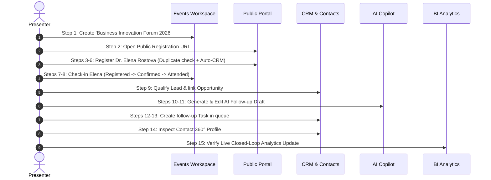

# EVENTFLOW — Live Demonstration Guide (3–5 Minutes)

> **Step-by-Step Presenter Walkthrough of the Business Innovation Forum 2026 Scenario.**

---

## 1. Demo Overview & Persona Framing

- **Presenter Persona**: Sarah Chen (Director of Field Marketing & Revenue Operations).
- **Target Audience**: VP of Marketing, Head of Sales / RevOps, Chief Revenue Officer.
- **Goal**: Demonstrate how EVENTFLOW eliminates the 5-day post-event lead decay by connecting live event operations, automated CRM ingestion, contextual AI drafting, and closed-loop revenue attribution in a single seamless flow.
- **Duration**: 3 to 5 minutes.
- **Scenario Event**: **Business Innovation Forum 2026** (Executive In-Person Technology Summit, capacity: 150).
- **Featured Prospect**: **Dr. Elena Rostova**, VP of Engineering at **Novatech Solutions** (Tier: Enterprise, Industry: Enterprise Software).

---

## 2. Preparation Checklist

1. Application running at `http://localhost:3000`.
2. Seed data loaded (`npx tsx prisma/seed.ts` or `POST /api/seed`).
3. Browser tabs prepared:
   - Tab 1: Executive Dashboard (`http://localhost:3000`)
   - Tab 2: Events Directory (`http://localhost:3000/events`)
   - Tab 3: CRM Contacts (`http://localhost:3000/crm`)
   - Tab 4: Public Registration Page (`http://localhost:3000/register/business-innovation-forum-2026`)

---

## 3. Step-by-Step Walkthrough Script



---

### Phase 1: Event Initialization & Public Portal (Steps 1–2)

#### Step 1: Create 'Business Innovation Forum 2026'
- **Action**: In `/events`, click **"Create Event"**. Enter:
  - **Title**: `Business Innovation Forum 2026`
  - **Slug**: `business-innovation-forum-2026`
  - **Type**: `Conference`
  - **Status**: `Published`
  - **Capacity**: `150`
  - **Budget**: `$45,000`
  - **Expected Revenue**: `$250,000`
  - **Dates**: Oct 14–15, 2026 | New York City, NY
- **Talking Point**: *"Instead of configuring 3 disconnected ticketing and marketing tools, marketing sets up the event in 30 seconds with native capacity tracking and financial targets."*

#### Step 2: Validate the Public Registration Portal
- **Action**: Click the generated public link: `/register/business-innovation-forum-2026`.
- **Observation**: Highlight the clean, distraction-free aesthetic, live seat counter, and mobile responsiveness.

---

### Phase 2: Live Attendee Registration & Zero-Friction CRM Ingestion (Steps 3–6)

#### Steps 3–6: Register Dr. Elena Rostova
- **Action**: In the registration form, enter:
  - **Name**: `Elena Rostova`
  - **Email**: `elena.rostova@novatech.io`
  - **Company**: `Novatech Solutions`
  - **Title**: `VP of Engineering`
  - **Ticket**: `VIP`
  - **UTM Source**: `LinkedIn`
- **Sub-check (Validation & Duplicate Prevention)**: 
  - Submit the form successfully. Notice the instantaneous confirmation screen.
  - Attempt to submit the exact same email again: show the polite duplicate rejection banner (*"Email already registered for this event"*).
- **Sub-check (Automated CRM Linkage)**:
  - Switch to the `/crm` tab.
  - Show that `Elena Rostova` has **already been created as a Contact**, mapped to `Novatech Solutions`, classified as `Enterprise`, with `leadScore: 85`.
- **Talking Point**: *"Zero manual CSV scrubbing. The moment Elena registered via LinkedIn, she was mapped into our enterprise account hierarchy with full UTM attribution."*

---

### Phase 3: Day-of Attendance Check-in & Status Lifecycle (Steps 7–8)

#### Steps 7–8: Check-in Attendee (`Registered` → `Confirmed` → `Attended`)
- **Action**: Return to `/events/[id]`, switch to the **Registrations** tab.
- **Action**: Locate Elena Rostova. Click the status badge to move status from `Registered` to `Confirmed`.
- **Action**: When Elena arrives on-site, click **"Check In"** (updating status to `Attended`).
- **Observation**: Timestamp `checkInTime` records in real-time, `attendedCount` increments, and a `CHECK_IN` activity is appended to the audit ledger.

---

### Phase 4: Lead Qualification & Pipeline Progression (Step 9)

#### Step 9: Qualify the Lead & Link Deal Opportunity
- **Action**: In the attendee row or contact drawer, update `Lead Status` from `New` to `Qualified`.
- **Action**: Create an Opportunity:
  - **Deal Title**: `Novatech - Enterprise Platform Expansion`
  - **Value**: `$75,000`
  - **Stage**: `Qualified` (Probability: 40%)
- **Talking Point**: *"The rep identifies Elena as an enterprise decision maker during the opening session and immediately upgrades her lead status, linking a $75k deal directly to this forum."*

---

### Phase 5: Contextual AI Follow-up & Task Automation (Steps 10–13)

#### Steps 10–11: Generate & Edit AI Follow-up Draft
- **Action**: In Elena's registration row or drawer, click **"Generate AI Follow-up"**.
- **Observation**: The AI Copilot inspects:
  1. The event theme (*Business Innovation Forum 2026*).
  2. Her company profile (*Novatech Solutions, Enterprise*).
  3. Her attendance status (*Attended*).
  4. On-site interaction note (*"Interested in reducing cloud compute latency by 40%"*).
- **Output**: The Copilot drafts a hyper-personalized email:
  - **Subject**: *Great connecting at Business Innovation Forum: Novatech's cloud latency goals*
  - **Body**: Personalized summary referencing her attendance and concrete next steps.
- **Action**: Click into the draft editor to tweak a sentence, showing the Human-in-the-Loop workflow.

#### Steps 12–13: Create Follow-up Task in Queue
- **Action**: Click **"Create Follow-up Task"** from the draft:
  - **Title**: `Send personalized follow-up to Elena Rostova`
  - **Priority**: `Urgent`
  - **Due Date**: Tomorrow 9:00 AM
- **Action**: Navigate to `/tasks`. Show the new task actively assigned in the queue with a direct link back to Elena.
- **Talking Point**: *"No leads slip through the cracks. In under 60 seconds from check-in, the SDR has a customized email draft and a scheduled task in their queue."*

---

### Phase 6: Contact 360° View & Closed-Loop Analytics (Steps 14–15)

#### Step 14: Inspect Contact 360° Profile
- **Action**: Navigate to `/crm/contacts/[id]` for Elena Rostova.
- **Observation**: Highlight the complete 360° record:
  - Personal & Corporate details.
  - Event Attendance: *Business Innovation Forum 2026 (VIP, Attended)*.
  - Associated Deal: *Novatech - Enterprise Platform Expansion ($75,000)*.
  - Active Task: *Send personalized follow-up*.
  - Activity Timeline: Complete audit history showing registration, check-in, lead status update, and AI draft generation.

#### Step 15: Closed-Loop Executive Analytics Verification
- **Action**: Navigate to `/analytics` (and `/api/analytics`).
- **Observation**: 
  - **Attendance Rate**: Dynamically reflects the new check-in.
  - **Lead Conversion Rate**: Automatically recalculates the ratio of attended attendees who became `Qualified Leads`.
  - **Attributed Pipeline**: Highlights the `$75,000` attributed to the Business Innovation Forum from LinkedIn.
- **Closing Statement**: *"With EVENTFLOW, the CMO and VP of Sales see the exact dollar return on every conference, while the sales team follows up within hours, not days."*

---

## 4. Standalone CLI Verification Command

To automatically run this entire 15-step scenario and verify all API assertions programmatically:

```bash
npx tsx scripts/test-e2e.ts
```
Expected output: **15/15 Scenario Steps PASSED, 4/4 Edge Cases PASSED (100% Success).**
