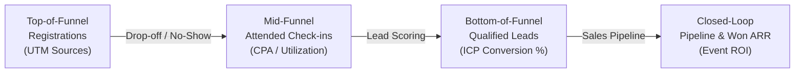
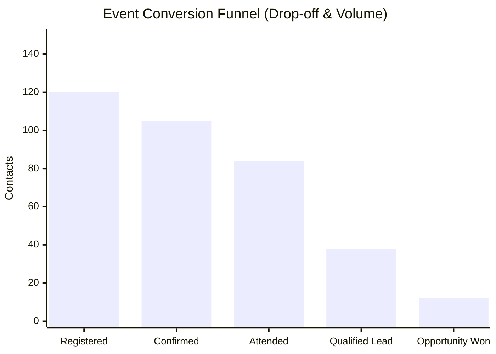

# EVENTFLOW — Metrics Framework & KPI Specifications

> **Definitions, Mathematical Formulas, Data Lineage, and Calculation Logic for Event-Led Revenue Operations.**

---

## 1. Overview & Framework

In modern B2B Go-To-Market (GTM) motions, **Event-Led Growth (ELG)** bridges brand awareness and closed-won enterprise revenue. Traditional event metrics have historically focused exclusively on vanity volume (e.g. "Total Signups"). EVENTFLOW implements a closed-loop measurement framework that evaluates:
1. **Operational Efficiency**: Venue capacity utilization, drop-off, and logistical pacing.
2. **Audience Engagement**: On-site attendance and session participation.
3. **Revenue Velocity**: Speed of lead qualification, pipeline creation, and monetary attribution.



---

## 2. Core KPI Definitions & Formulas

### 2.1 Attendance Rate
- **Definition**: The proportion of registered visitors who actually completed physical or virtual check-in.
- **Business Impact**: Benchmark of attendee commitment, topic relevance, and day-of reminder effectiveness.
- **Formula**:
  $$\text{Attendance Rate} = \left( \frac{\text{Total Attended Registrations}}{\text{Total Registrations}} \right) \times 100\%$$
- **Edge Cases**:
  - If `Total Registrations == 0`, `Attendance Rate = 0.0%`.
  - Excludes records with `Cancelled` status from both numerator and denominator if cancelled prior to the event.
- **Target Benchmark**:
  - In-person B2B conferences: 65% – 75%.
  - Virtual webinars: 40% – 50%.

---

### 2.2 Capacity Utilization
- **Definition**: The percentage of the event's allocated venue capacity filled by registered attendees.
- **Business Impact**: Prevents overbooking liabilities and surfaces under-promoted events in time for marketing intervention.
- **Formula**:
  $$\text{Capacity Utilization} = \left( \frac{\text{Total Registrations}}{\text{Max Venue Capacity}} \right) \times 100\%$$
- **Operational Triggers**:
  - `< 60%` at 2 weeks out: Triggers automated promotion notification.
  - `>= 95%`: Triggers public registration warning banner.
  - `= 100%`: Locks registration form and activates waitlist mode.

---

### 2.3 No-Show Rate
- **Definition**: The percentage of confirmed registrants who failed to check in.
- **Formula**:
  $$\text{No-Show Rate} = \left( \frac{\text{No-Show Registrations}}{\text{Total Registrations}} \right) \times 100\% = 100\% - \text{Attendance Rate}$$
- **Operational Action**: Automatically triggers AI "Missed You" nurture email offering event session slide deck and on-demand replay.

---

### 2.4 Cost Per Attendee (CPA)
- **Definition**: The actual marketing cost expended for each verified attendee who checked into the event.
- **Formula**:
  $$\text{Cost Per Attendee (CPA)} = \frac{\text{Total Actual Event Budget Spent}}{\text{Total Attended Registrations}}$$
- **Data Source**: `Event.budget` divided by `Event.attendedCount`.
- **Target Benchmark**:
  - Regional executive dinner: $300 – $600 per attendee.
  - Multi-day flagship summit: $800 – $1,500 per attendee.
  - Virtual workshop: $25 – $60 per attendee.

---

### 2.5 Lead Qualification Rate (Conversion Rate)
- **Definition**: The ratio of verified event attendees who are converted to `Qualified Lead` status or higher in the CRM.
- **Formula**:
  $$\text{Lead Conversion Rate} = \left( \frac{\text{Attended Contacts with LeadStatus} \in \{\text{Qualified}, \text{Customer}\}}{\text{Total Attended Registrations}} \right) \times 100\%$$
- **Target Benchmark**: 25% – 40% for targeted B2B events.

---

### 2.6 Pipeline Generated & Attributed Revenue
- **Pipeline Generated**: The gross monetary value of all active CRM opportunities associated with contacts who registered for or attended the event.
  $$\text{Pipeline Generated} = \sum \text{Opportunity.value} \quad \forall \; \text{Opportunity.eventId} = \text{event.id}$$
- **Weighted Pipeline**:
  $$\text{Weighted Pipeline} = \sum (\text{Opportunity.value} \times \text{Opportunity.probability} / 100)$$
- **Attributed Closed-Won Revenue**:
  $$\text{Attributed Revenue} = \sum \text{Opportunity.value} \quad \forall \; \text{Opportunity.stage} = \text{'Won'}$$

---

### 2.7 Channel Acquisition Efficiency (UTM Attribution)
- **Definition**: Comparative yield per marketing acquisition channel (`LinkedIn`, `Partner`, `Email`, `Direct`, `Organic`).
- **Formulas per Channel**:
  - **Channel Volume Share (%)**: $(\text{Registrations}_{\text{channel}} / \text{Total Registrations}) \times 100\%$
  - **Channel Conversion Rate (%)**: $(\text{Attended}_{\text{channel}} / \text{Registrations}_{\text{channel}}) \times 100\%$
  - **Channel Pipeline Yield ($)**: $\sum \text{Opportunity.value}_{\text{channel}}$

---

## 3. The Closed-Loop Event Conversion Funnel

The EVENTFLOW Analytics engine models the sequential 5-stage conversion waterfall:



| Stage | Trigger Event | State Field in DB |
| :--- | :--- | :--- |
| **1. Registered** | Initial form submission on `/register/[slug]` | `Registration.status = 'Registered'` |
| **2. Confirmed** | Attendee responds to email confirmation | `Registration.status = 'Confirmed'` |
| **3. Attended** | On-site badge scan or staff check-in | `Registration.status = 'Attended'` |
| **4. Qualified Lead** | AI or SDR verifies ICP fit & intent | `Contact.leadStatus = 'Qualified'` |
| **5. Won Deal** | Contract executed in CRM pipeline | `Opportunity.stage = 'Won'` |

---

## 4. Aggregation Logic & SQL / Prisma Implementation

All metrics exposed by `/api/analytics` are calculated dynamically from atomic relational records to ensure continuous real-time accuracy:

```typescript
// Core Aggregation Implementation Pattern
export async function calculateEventMetrics(eventId: string) {
  const event = await prisma.event.findUnique({
    where: { id: eventId },
    include: {
      registrations: {
        include: { contact: true }
      },
      opportunities: true
    }
  });

  const totalRegistered = event.registrations.length;
  const totalAttended = event.registrations.filter(r => r.status === 'Attended').length;
  const totalConfirmed = event.registrations.filter(r => r.status === 'Confirmed').length;
  const noShows = event.registrations.filter(r => r.status === 'No-show').length;

  const attendanceRate = totalRegistered > 0 ? (totalAttended / totalRegistered) * 100 : 0;
  const capacityUtilization = event.capacity > 0 ? (totalRegistered / event.capacity) * 100 : 0;
  const costPerAttendee = totalAttended > 0 ? (event.budget / totalAttended) : 0;

  const qualifiedLeads = event.registrations.filter(r => 
    r.status === 'Attended' && 
    (r.contact.leadStatus === 'Qualified' || r.contact.leadStatus === 'Customer')
  ).length;

  const leadConversionRate = totalAttended > 0 ? (qualifiedLeads / totalAttended) * 100 : 0;

  const totalPipeline = event.opportunities.reduce((acc, opp) => acc + opp.value, 0);
  const wonRevenue = event.opportunities
    .filter(opp => opp.stage === 'Won')
    .reduce((acc, opp) => acc + opp.value, 0);

  return {
    totalRegistered,
    totalAttended,
    totalConfirmed,
    noShows,
    attendanceRate: Number(attendanceRate.toFixed(1)),
    capacityUtilization: Number(capacityUtilization.toFixed(1)),
    costPerAttendee: Math.round(costPerAttendee),
    qualifiedLeads,
    leadConversionRate: Number(leadConversionRate.toFixed(1)),
    totalPipeline,
    wonRevenue
  };
}
```

---

## 5. Follow-up SLA & Velocity Tracking

In addition to volume and monetary metrics, EVENTFLOW tracks operational agility:
- **Lead Follow-up Velocity (Time to First Touch)**:
  $$\text{Follow-up Velocity} = \text{Task.createdAt} - \text{Registration.checkInTime}$$
- **SLA Violation**: Flagged in red if an attendee with `status = 'Attended'` has no follow-up task or logged activity within **24 hours** of event conclusion.
