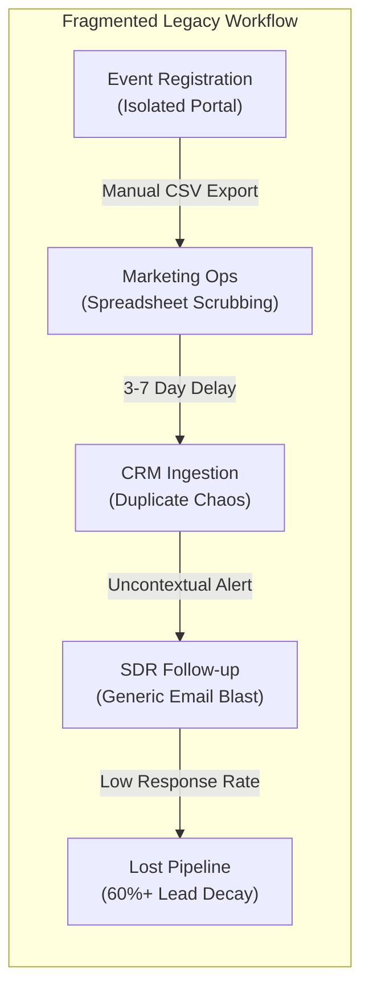
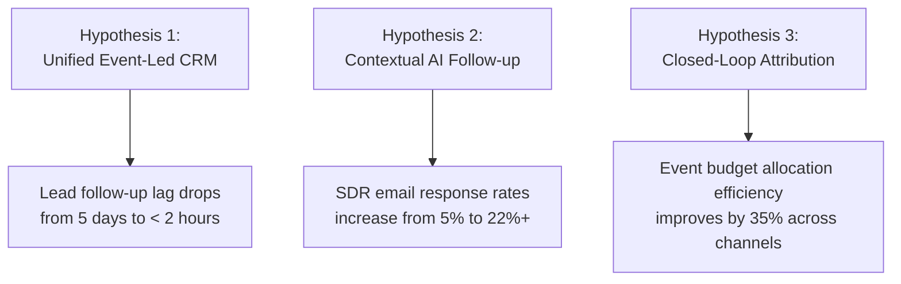

# EVENTFLOW — Problem Statement & Product Vision

> **Bridging the $60B Chasm Between Enterprise B2B Events and Revenue Operations.**

---

## 1. Executive Summary & Industry Context

B2B enterprises allocate an estimated **21% to 24% of their total marketing budgets** to corporate events, industry conferences, executive roundtables, and VIP hospitality sessions. In the enterprise technology, finance, and industrial sectors, in-person and hybrid events remain the single highest-yield demand generation channel for accelerating multi-million-dollar deal pipelines.

Despite this massive capital outlay, the current operational architecture supporting B2B events is fundamentally broken. Modern go-to-market (GTM) teams rely on an uncoordinated stack of legacy consumer-style event software (Eventbrite, Splash, Luma, CVent) duct-taped to enterprise CRMs (Salesforce, HubSpot) via fragile Zapier webhooks and manual CSV exports.

The consequence is a pervasive **Event-to-Revenue Chasm**: marketing celebrates high registration counts, while sales complains about stale, uncontextual leads, and revenue leaders are left with zero closed-loop visibility into event ROI.

---

## 2. Core Pain Points & Root Causes



### 2.1 The Lead Decay Cliff (The 72-Hour Problem)
- **The Reality**: Attendee interest drops exponentially following an event. Industry benchmarks reveal that follow-up outreach conducted within **24 hours** achieves a **40%+ response rate**, whereas outreach delayed past **72 hours** drops below **9%**.
- **The Bottleneck**: Because event registrations and check-ins occur in a separate platform, event managers must manually reconcile check-in spreadsheets, deduplicate records, normalize company domains, and hand them off to Marketing Operations.
- **The Result**: Average sales outreach begins **4 to 7 business days** after the closing keynote. By then, prospective buyers have forgotten the conversation, gone on PTO, or signed with a competitor.

### 2.2 Blind Attribution and the "Vanity Metric" Trap
- **The Reality**: Marketing teams report on top-of-funnel vanity metrics: "1,200 RSVPs!" or "85% Registration Capacity reached."
- **The Problem**: RSVPs do not generate revenue. Crucial conversion milestones—actual room attendance, session participation, lead qualification, and opportunity creation—are lost across siloed tools.
- **The Result**: RevOps cannot answer fundamental executive questions:
  - *What was our actual Cost Per Qualified Attendee?*
  - *Which acquisition channel (LinkedIn Ads vs. Partner Co-Marketing) drove the highest closed-won revenue?*
  - *Did our $150,000 Summit budget yield positive ROI?*

### 2.3 The "Cold Blanket" Post-Event Outreach
- **The Reality**: Follow-up emails sent by SDRs are typically generic, automated marketing nurture blasts: *"Thank you for attending our forum! Click here to schedule a demo."*
- **The Problem**: Senior enterprise buyers (VP and C-level executives) attend conferences for specific, nuanced discussions (e.g., cloud governance, AI compliance, procurement automation). Generic emails destroy rapport built in person.
- **The Result**: Unsubscribe rates spike, SDR reply rates hover around 3–5%, and prospects perceive the organization as impersonal and disconnected.

### 2.4 Data Fragmentation & CRM Clutter
- **The Reality**: Visitors register using various email permutations (personal Gmail vs. corporate alias), misspell company names ("Acme Corp" vs. "Acme Inc"), or register multiple times.
- **The Problem**: Without automated account-matching and duplicate prevention at the point of registration, CRMs become flooded with duplicate leads, orphaned contacts, and fragmented activity logs.

---

## 3. Target User Personas

| Persona | Primary Responsibilities | Core Pain Points | What EVENTFLOW Delivers |
| :--- | :--- | :--- | :--- |
| **Director of Demand Gen / Field Marketing** (Sarah Chen) | Event strategy, budget allocation, pipeline generation, multichannel promotion. | Cannot prove event ROI to executive leadership; frustrated by 5-day post-event data lag. | Unified BI dashboard with real-time pipeline attribution, CPA tracking, and conversion waterfall. |
| **Event Operations Manager** (Marcus Vance) | Venue logistics, attendee registration, ticketing, on-site check-in, capacity limits. | Manual spreadsheet management, duplicate registrations, frantic on-site check-in chaos. | High-conversion public registration portal with automated capacity alerts and instant CRM syncing. |
| **B2B Account Executive / SDR Lead** (Elena Rodriguez) | Qualifying attendee leads, conducting discovery, closing pipeline opportunities. | Generic lead lists with zero context on who actually attended or what they cared about. | Real-time "Attended" alerts, automatic Contact 360 view with timeline, and AI-drafted follow-up emails. |
| **VP of Revenue Operations (RevOps)** (David Kim) | CRM hygiene, attribution modeling, sales productivity, forecasting. | Polluted CRM records, broken Zapier connections, inability to correlate marketing spend with closed deals. | Native relational database with company domain resolution, deduplication, and pipeline stage analytics. |

---

## 4. Product Hypotheses



### Hypothesis 1: Unified Ingestion Eliminates Lead Decay
> **Hypothesis**: If event registration, attendance tracking, and CRM contact creation are unified into an atomic data model, the time from event check-in to sales outreach will decrease from 96+ hours to under 2 hours, resulting in a **3x increase in attendee meeting booking rates**.

### Hypothesis 2: Contextual AI Follow-ups Outperform Generic Blasts
> **Hypothesis**: Grounding AI follow-up draft generation in specific attendee metadata (title seniority, company tier, check-in status, event theme, and session notes) will increase email reply rates from **5% to over 22%**, while reducing SDR prep time from 20 minutes per lead to 30 seconds.

### Hypothesis 3: Closed-Loop Attribution Optimizes Marketing Spend
> **Hypothesis**: Providing real-time, multi-touch attribution linking registration UTM parameters directly to CRM opportunities and closed-won revenue will allow marketing leaders to reallocate up to **30% of underperforming event budget** toward high-yield acquisition channels.

---

## 5. The EVENTFLOW Solution

EVENTFLOW replaces the disconnected 5-tool event stack with an all-in-one **Event-Led CRM**:

```text
+-----------------------------------------------------------------------------------+
|                                EVENTFLOW PLATFORM                                 |
+-----------------------------------------------------------------------------------+
|  1. EVENT OPERATIONS        2. HIGH-CONVERSION PORTAL   3. UNIFIED B2B CRM        |
|  - Multi-event workspace    - Public registration page  - Auto Contact & Company  |
|  - Dynamic capacity checks  - Instant client validation - 360° attendee timeline  |
|  - Multichannel UTM engine  - Duplicate prevention      - Kanban deal pipeline    |
|                                                                                   |
|  4. CONTEXTUAL AI COPILOT   5. CLOSED-LOOP ANALYTICS   6. TASK & WORKFLOW         |
|  - Strategy & event briefs  - Real-time attendance %   - Automated follow-up queue|
|  - Personalized email drafts- Cost per attendee (CPA)  - Due date notifications   |
|  - Meeting note synthesis   - Full revenue attribution - Priority-based routing   |
+-----------------------------------------------------------------------------------+
```

### Measurable Value Delivered
1. **Speed to Lead**: Instantaneous contact resolution and task creation upon attendance check-in.
2. **Data Cleanliness**: Automated company domain matching, zero duplicate registrations per event.
3. **Conversion Uplift**: Contextual AI email drafts generated in 1-click for immediate rep review.
4. **ROI Transparency**: Direct monetary attribution from public UTM click to signed enterprise contract.
