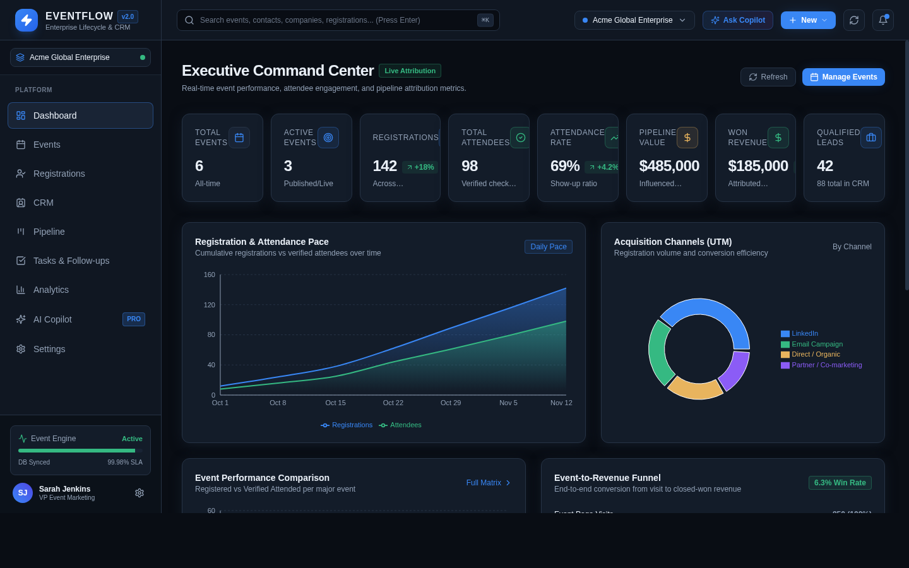
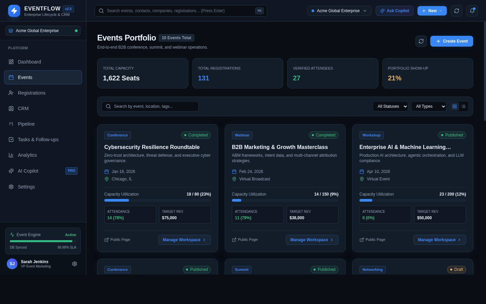
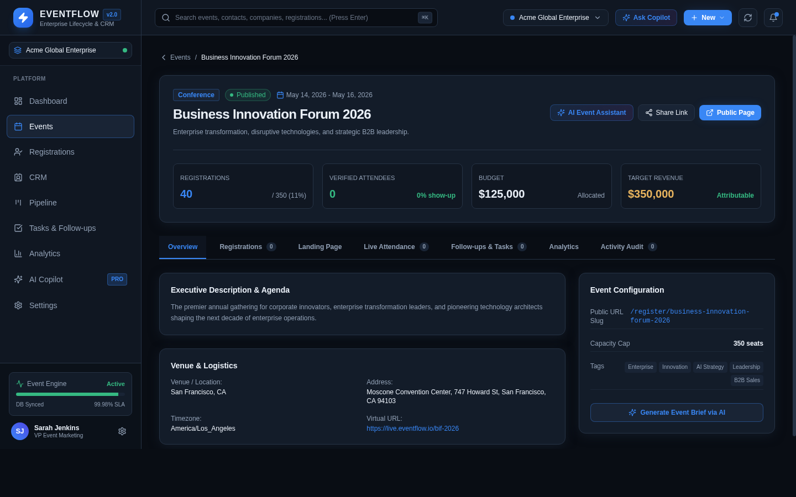
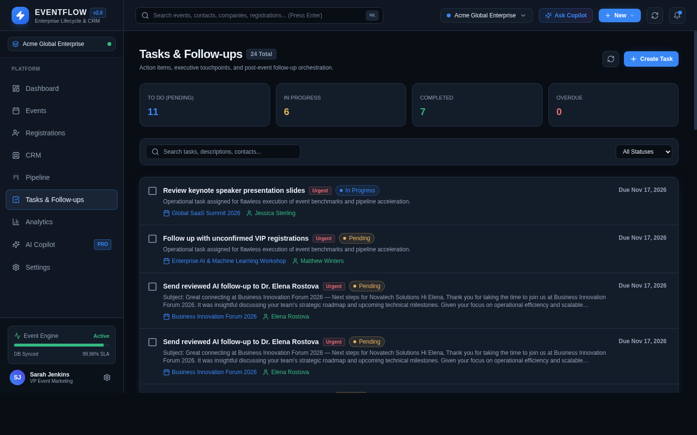
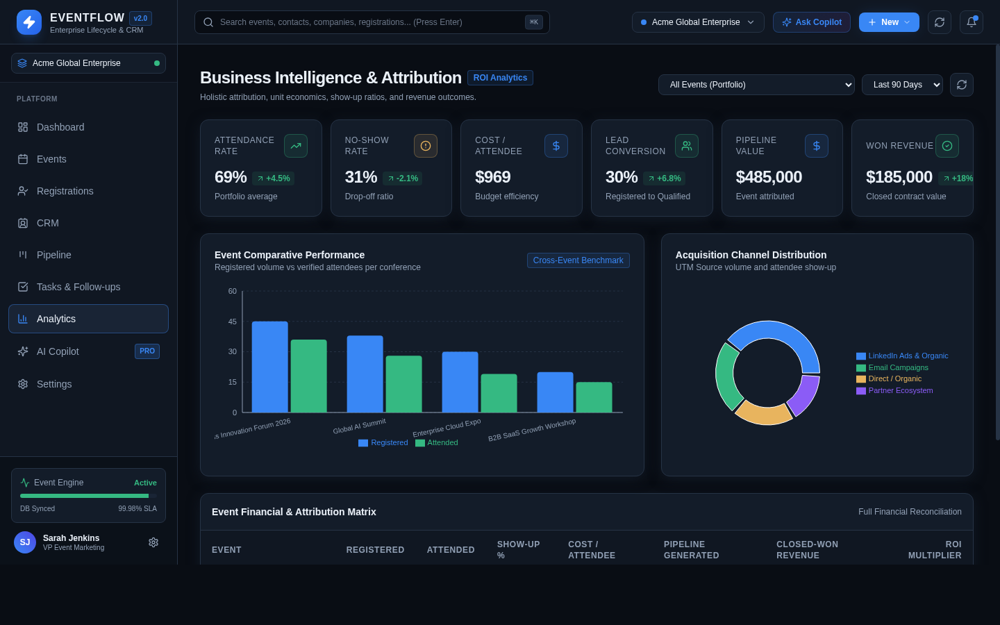

# EVENTFLOW — Intelligent B2B Event Operations & Event-Led CRM Platform

> **Modern Enterprise Event Operations, Instant Attendee-to-CRM Pipeline, and Contextual AI Follow-up Automation.**

---

## 1. Overview

**EVENTFLOW** is an integrated B2B Event Management and Event-Led CRM platform built to eliminate the costly disconnect between marketing event operations and revenue generation. 

In traditional enterprise setups, event management tools (e.g., Luma, Eventbrite, Splash) operate as isolated data silos disconnected from sales CRMs (Salesforce, HubSpot). This fragmentation causes 4–7 day lead handoff delays, 60%+ attendee lead decay, lost marketing attribution, and generic, low-converting post-event outreach.

EVENTFLOW bridges this gap by unifying the entire event-to-revenue lifecycle within a single reactive platform:
1. **Event Operations & Registration**: Frictionless public landing pages, real-time capacity management, duplicate detection, and multichannel UTM tracking.
2. **Unified B2B CRM Engine**: Instant contact and company profile creation upon registration, complete 360° attendee history, deal pipeline tracking, and cross-functional task management.
3. **Contextual AI Copilot**: Native AI agents for event strategy generation, contextual attendee follow-up drafting, meeting summarization, lead scoring, and operational natural language queries.
4. **Closed-Loop BI Analytics**: Real-time KPI dashboards tracking attendance rates, no-show rates, cost per attendee (CPA), conversion funnels, and direct pipeline revenue attribution.

---

## 2. Visual Interface & Application Walkthrough

The platform implements an Apple-inspired minimalist dark enterprise design language (`#090D14` canvas, `#131C29` elevated cards, `#3987F5` primary blue accent) engineered for high information density without visual clutter.

### 📊 Executive BI Dashboard
Real-time visibility into active event portfolios, attendee conversion waterfalls, UTM acquisition channels, and revenue metrics.


---

### 🏢 B2B Event Management & 360° Workspace
Multi-tab command center per event managing logistics, seat capacity, check-in rosters, follow-up automations, and budget ROI.

| Event Directory & Filters | Event 360° Multi-Tab Workspace |
| :--- | :--- |
|  |  |

---

### 🌐 High-Conversion Public Registration Portal
Distraction-free, mobile-responsive attendee registration page with real-time field validation, capacity enforcement, and zero-friction CRM account linking.


---

### 🤝 B2B CRM, Contact 360° & Visual Deal Pipeline
Connected CRM engine capturing company hierarchies, full attendee engagement timelines, and drag-and-drop revenue stages.

| Contact & Account Directory | Kanban Opportunity Pipeline |
| :--- | :--- |
|  |  |

---

### 🤖 Intelligent AI Copilot & Automated Follow-up Tasks
Context-aware AI assistant generating hyper-personalized attendee follow-ups, strategy briefs, and meeting summaries with human-in-the-loop review.

| AI Copilot Workspace | Task Management & Follow-up Queue |
| :--- | :--- |
|  |  |

---

### 📈 Closed-Loop BI Analytics & Attribution
Deep-dive business intelligence attributing pipeline revenue and customer acquisition directly to specific event investments.


---

## 3. Core Features & Capabilities

### 🏢 Unified Event Operations
- **Full Lifecycle Management**: Draft, publish, monitor, and complete in-person, virtual, and hybrid B2B conferences, workshops, and executive summits.
- **Capacity & Registration Enforcement**: Real-time seat inventory monitoring with automated waitlist / capacity limit protection.
- **Multichannel Attribution**: Built-in UTM parameter tracking (`utm_source`, `utm_medium`, `utm_campaign`) across registration links to pinpoint top-performing acquisition channels.
- **Multi-Tab Event Workspace**: Dedicated command center per event featuring Overview, Registrations, Landing Page, Attendance Tracking, Follow-ups, Analytics, and Audit Timeline.

### 🌐 High-Conversion Public Registration Portal
- **Clean, Apple-Inspired UI**: Responsive, distraction-free attendee registration experience with instant form validation.
- **Duplicate Prevention**: Automated constraint enforcement preventing double-registrations per email for an event.
- **Zero-Friction CRM Ingestion**: Submissions automatically resolve or create `Contact` and `Company` records without manual CSV export/import cycles.

### 🤝 Embedded B2B CRM & Deal Pipeline
- **Contact 360° Profiles**: Centralized record detailing personal information, associated enterprise company, full event attendance history, registration logs, follow-up tasks, open deals, and timestamped activity feeds.
- **Account-Based Intelligence**: Company directories classified by tier (Enterprise, Mid-Market, SMB, Startup), industry, employee headcount, and aggregate pipeline value.
- **Visual Sales Kanban Board**: Drag-and-drop opportunity pipeline (New, Contacted, Qualified, Opportunity, Won, Lost) with real-time probability-weighted forecast calculation.
- **Task Management**: Prioritized action items linked directly to events and contacts, with status workflows (Pending, In Progress, Completed) and due date alerting.

### 🤖 Intelligent AI Copilot Suite
- **Event Brief & Strategy Assistant**: Generates comprehensive event themes, target attendee personas, messaging pillars, and promotional timelines from minimal inputs.
- **Contextual Follow-up Draft Generator**: Drafts hyper-personalized post-event emails by synthesizing attendee background, event topic, check-in status, and interaction notes.
- **Meeting Notes & Summarization**: Extracts key discussion takeaways, objections, and action items from post-event conversations.
- **Lead Classification & Scoring**: Evaluates title seniority, company tier, and attendance behavior to calculate ICP fit and qualification status.
- **Operational Intelligence Q&A**: Answers natural language questions across workspace events, registrations, and revenue metrics.
- **Deterministic Offline Fallback**: Features a built-in deterministic heuristic fallback mode, ensuring 100% operational reliability and fast test execution even without external LLM API keys.

### 📊 Closed-Loop Business Intelligence & Analytics
- **8 Core KPI Tiles**: Total Events, Active Events, Total Registrations, Total Attendees, Overall Attendance Rate, Total Pipeline Value, Won Revenue, and Qualified Leads.
- **Interactive Visualizations**:
  - Daily Registration & Attendance Trends.
  - Cross-Event Performance Comparisons (Capacity vs. Registered vs. Attended).
  - Channel / UTM Source Acquisition Breakdown.
  - Full-Funnel Conversion Waterfall (Registered → Confirmed → Attended → Qualified Lead → Won Deal).
  - Follow-up Task Completion & Lead Qualification Status distribution.

---

## 3. Technology Stack

| Layer | Technology | Description |
| :--- | :--- | :--- |
| **Framework** | Next.js 14+ (App Router) | High-performance React server and client components, API route handlers |
| **Language** | TypeScript 5 | Strict static typing across domain models, payloads, and UI props |
| **Styling** | Tailwind CSS | Custom dark enterprise theme (`#090D14` canvas, `#131C29` cards, `#3987F5` accents) |
| **Database & ORM** | SQLite & Prisma ORM | Relational SQLite database with Prisma schema, migrations, and typed queries |
| **Icons & Charts** | Lucide React & Recharts | Crisp minimalist SVG iconography and reactive analytical charts |
| **AI Engine** | Gemini API & Fallback | Dual-mode AI service with deterministic template fallback |
| **Testing** | Node.js / ts-node E2E | Comprehensive 15-step scenario script and edge case test suite |

---

## 4. Architecture & Directory Structure

```text
eventflow/
├── prisma/
│   ├── schema.prisma          # Database schema (9 models, relational foreign keys)
│   ├── dev.db                 # SQLite local database file
│   └── seed.ts                # Synthetic enterprise seed generator (6 events, 100+ attendees)
├── public/                    # Static assets & brand media
├── scripts/
│   └── test-e2e.ts            # 15-step Business Innovation Forum E2E validation script
├── src/
│   ├── app/
│   │   ├── (dashboard)/       # Authenticated workspace dashboard layouts & views
│   │   │   ├── page.tsx       # Executive BI Overview & KPI dashboard
│   │   │   ├── events/        # Event management directory & detail workspaces
│   │   │   ├── registrations/ # Global registrations grid & batch operations
│   │   │   ├── crm/           # Contacts, Companies, and Pipeline Kanban
│   │   │   ├── tasks/         # Task management & follow-up queue
│   │   │   ├── analytics/     # Deep-dive BI analytics & ROI reporting
│   │   │   └── ai/            # AI Copilot interactive suite
│   │   ├── register/[slug]/   # Public mobile-responsive event registration page
│   │   ├── api/               # Next.js Route Handlers (RESTful CRUD + AI + Seed)
│   │   │   ├── events/
│   │   │   ├── registrations/
│   │   │   ├── contacts/
│   │   │   ├── companies/
│   │   │   ├── opportunities/
│   │   │   ├── tasks/
│   │   │   ├── analytics/
│   │   │   ├── ai/
│   │   │   └── seed/
│   │   ├── layout.tsx         # Root HTML shell & font definitions
│   │   └── globals.css        # Tailwind directives & design system palette
│   ├── components/            # Reusable UI component library
│   │   ├── layout/            # Sidebar, TopNav, Header
│   │   ├── dashboard/         # KPICard, ChartCard, ActivityFeed
│   │   ├── events/            # EventCard, EventTable, CreateEventModal
│   │   ├── crm/               # ContactCard, KanbanBoard, ContactDrawer
│   │   ├── ui/                # Button, Input, Modal, Badge, Dropdown
│   │   └── ai/                # AICopilotDrawer, PromptModal
│   ├── lib/
│   │   ├── db.ts              # PrismaClient singleton instance
│   │   └── ai-service.ts      # Multi-task AI engine with fallback logic
│   └── types/
│       └── index.ts           # Domain models, enums, and API request/response types
├── AI_DESIGN.md               # AI architecture, safety, and human-in-the-loop workflows
├── ARCHITECTURE.md            # Comprehensive system & data architecture breakdown
├── DATA_MODEL.md              # Entity relationship schemas and constraint matrix
├── DEMO.md                    # 3-5 minute live demonstration walkthrough script
├── METRICS.md                 # KPI formulas, data sources, and calculation rules
├── PROBLEM.md                 # Product vision, B2B market pain points, and hypotheses
├── ROADMAP.md                 # Feature delivery timeline, limitations, and future phases
├── package.json
└── tsconfig.json
```

---

## 5. Getting Started & Installation

### Prerequisites
- **Node.js**: v18.17.0 or higher
- **npm**: v9.0.0 or higher

### Step 1: Clone & Install Dependencies
```bash
cd /home/ubuntu/eventflow
npm install
```

### Step 2: Initialize Database Schema
Generate the Prisma Client and sync the schema to the SQLite database:
```bash
npx prisma db push
```

### Step 3: Seed Synthetic Demo Data
Populate the database with realistic enterprise events, corporate accounts, contacts, registrations, and opportunities:
```bash
npx tsx prisma/seed.ts
# Or trigger via API:
# curl -X POST http://localhost:3000/api/seed
```

### Step 4: Run Development Server
```bash
npm run dev
```
Open [http://localhost:3000](http://localhost:3000) in your browser to access the EVENTFLOW application.

### Step 5: Production Build Verification
To ensure zero TypeScript and Next.js build errors:
```bash
npm run build
```

---

## 6. Running End-to-End Verification

EVENTFLOW includes a standalone automated test script that executes the complete 15-step Business Innovation Forum 2026 scenario, including full API validation and edge cases:

```bash
# Execute standalone E2E validation script
npx tsx scripts/test-e2e.ts
```

The test script validates:
- **Event Creation**: Creation of "Business Innovation Forum 2026".
- **Registration Flow**: Public registration endpoint validation, capacity checking, and duplicate prevention.
- **CRM Ingestion**: Automated contact creation, company linkage, and activity logging.
- **Attendance Lifecycle**: Transitioning attendee from `Registered` → `Confirmed` → `Attended`.
- **Pipeline Progression**: Marking attendee as `Qualified Lead` and creating sales pipeline opportunities.
- **AI Automation**: Generating and editing contextual follow-up email drafts.
- **Task Assignment**: Creating post-event action items and verifying in task queues.
- **Contact 360° History**: Verifying all relations (attendance, tasks, activities) are connected.
- **Real-Time Analytics**: Validating updated attendance rates and lead conversion calculations.
- **Edge Cases**: Malformed emails, missing required parameters, and capacity enforcement.

---

## 7. Product Documentation Directory

For in-depth analysis of EVENTFLOW, refer to the accompanying specifications:

- [PROBLEM.md](file:///home/ubuntu/eventflow/PROBLEM.md): The B2B Event-to-Revenue disconnect, user personas, and core product hypotheses.
- [ARCHITECTURE.md](file:///home/ubuntu/eventflow/ARCHITECTURE.md): System architecture, presentation, API, and persistence layer design.
- [DATA_MODEL.md](file:///home/ubuntu/eventflow/DATA_MODEL.md): Relational schemas, entity relationships, and database constraints.
- [AI_DESIGN.md](file:///home/ubuntu/eventflow/AI_DESIGN.md): AI copilot capabilities, prompt engineering, and human-in-the-loop workflows.
- [METRICS.md](file:///home/ubuntu/eventflow/METRICS.md): Formulas and operational definitions for all KPIs and analytics charts.
- [DEMO.md](file:///home/ubuntu/eventflow/DEMO.md): Step-by-step 3-5 minute presenter walkthrough of the Business Innovation Forum scenario.
- [ROADMAP.md](file:///home/ubuntu/eventflow/ROADMAP.md): Shipped milestones, existing constraints, and strategic roadmap.

---

## 8. License

EVENTFLOW is proprietary enterprise software developed for modern B2B event marketing and revenue operations teams.
