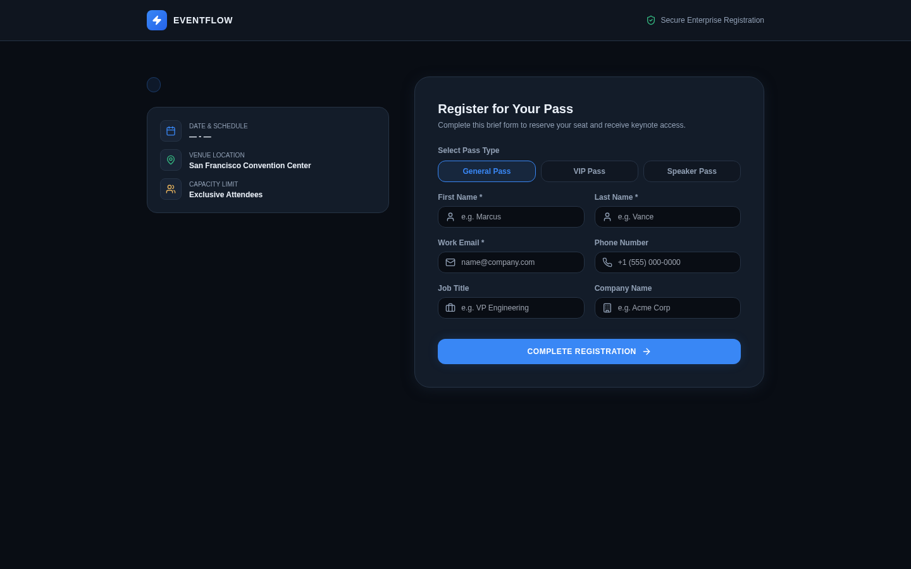
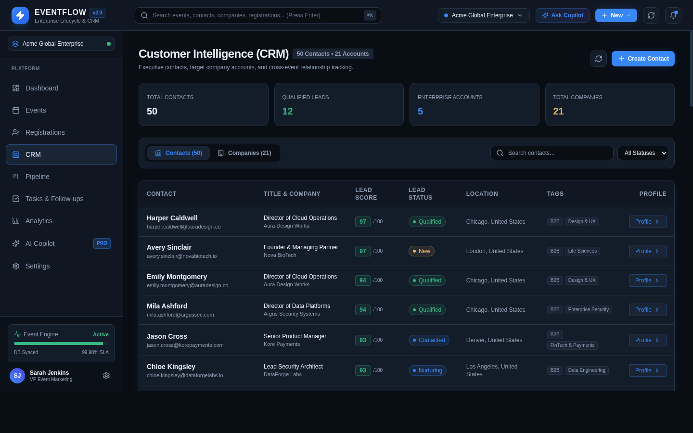
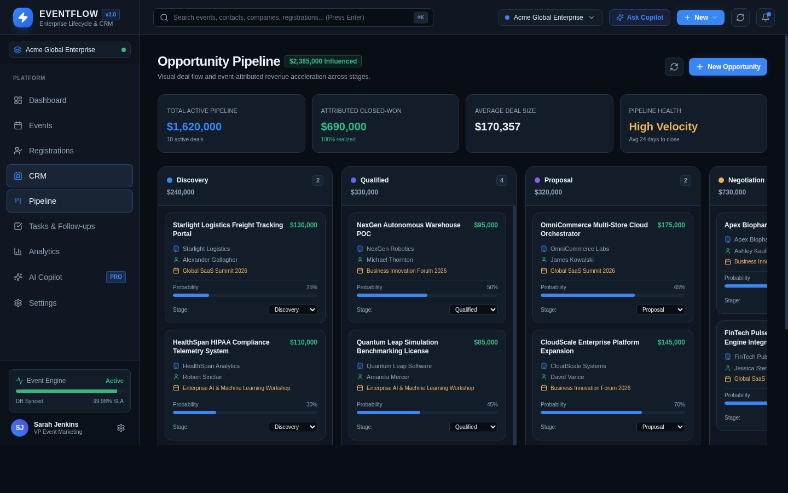
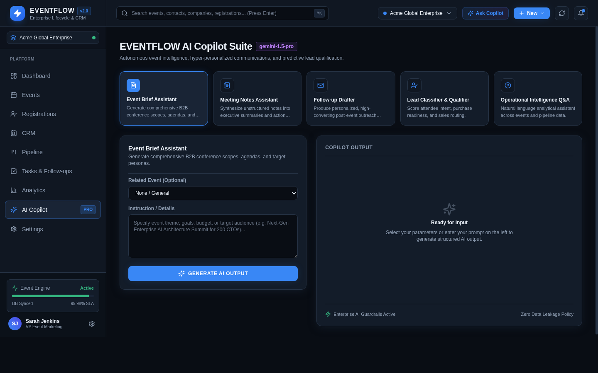
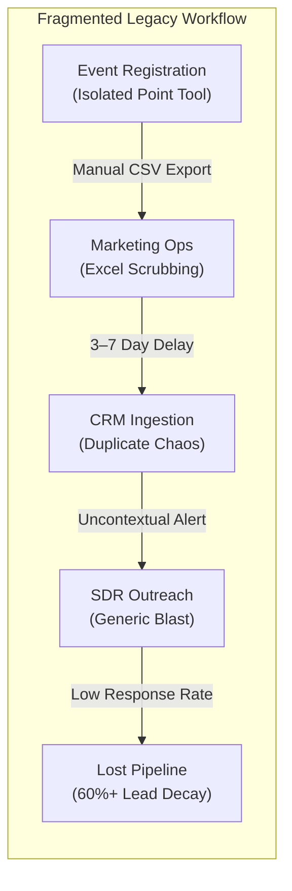
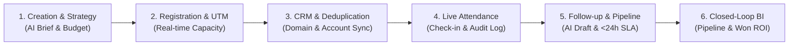
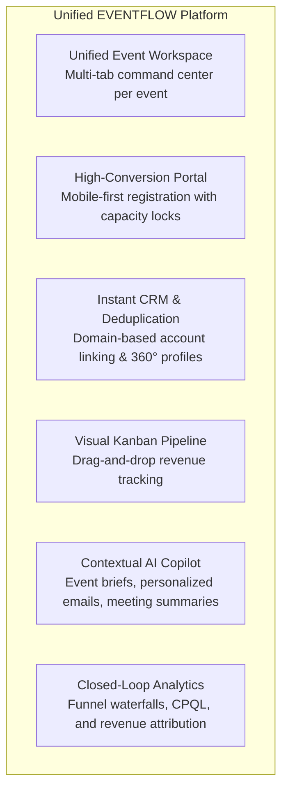

# EVENTFLOW — Intelligent B2B Event Operations & Event-Led CRM Platform

> **Modern Enterprise Event Operations, Frictionless Attendee-to-CRM Ingestion, Contextual AI Follow-up Automation, and Closed-Loop Revenue Attribution.**

[](https://nextjs.org/)
[](https://www.typescriptlang.org/)
[](https://www.prisma.io/)
[](https://www.sqlite.org/)
[](https://tailwindcss.com/)
[](scripts/test-e2e.ts)
[](src/lib/ai-service.ts)

---

> [!IMPORTANT]
> **PORTFOLIO DISCLAIMER**: Independent portfolio prototype. Not affiliated with Beeline or built using Beeline's internal systems. This repository represents an independent technical and business process case study demonstrating modern Event-Led Growth (ELG) architecture and full-stack enterprise engineering.

---

## 📑 Table of Contents

1. [Executive Summary](#1-executive-summary)
2. [Visual Interface & Application Tour](#2-visual-interface--application-tour)
3. [Case Study: PROBLEM](#3-case-study-the-problem)
4. [Case Study: PROCESS](#4-case-study-the-business-process)
5. [Case Study: SOLUTION](#5-case-study-the-solution)
6. [Case Study: IMPLEMENTATION & ARCHITECTURE](#6-case-study-technical-implementation--architecture)
7. [Case Study: VALIDATION & QUALITY ASSURANCE](#7-case-study-validation--quality-assurance)
8. [Case Study: NEXT STEPS & FEATURE MATRIX](#8-case-study-next-steps--feature-matrix)
9. [Getting Started & Installation](#9-getting-started--installation)
10. [Demo Credentials & Sample Data](#10-demo-credentials--sample-data)
11. [AI Copilot Configuration](#11-ai-copilot-configuration)
12. [In-Depth Documentation Index](#12-in-depth-documentation-index)

---

## 1. Executive Summary

**EVENTFLOW** is an integrated B2B Event Management and Event-Led CRM platform built to eliminate the costly disconnect between marketing event execution and revenue pipeline generation.

In traditional enterprise setups, event management tools (e.g., Luma, Eventbrite, Splash) operate as isolated data silos disconnected from sales CRMs (Salesforce, HubSpot). This fragmentation causes 4–7 day lead handoff delays, 60%+ attendee lead decay, lost marketing attribution, and generic, low-converting post-event outreach.

EVENTFLOW bridges this chasm by unifying the entire event-to-revenue lifecycle within a single reactive platform:
- **Event Operations & Logistics**: High-conversion public registration portals, real-time seat inventory, and multichannel UTM tracking.
- **Unified B2B CRM Engine**: Instant contact and account creation upon registration, complete 360° attendee history, deal pipeline tracking, and cross-functional task queues.
- **Contextual AI Copilot**: Native AI agents for event strategy briefs, contextual attendee follow-up drafting, meeting summarization, lead scoring, and natural language operational queries.
- **Closed-Loop BI Analytics**: Real-time KPI dashboards tracking attendance rates, no-show rates, cost per qualified lead (CPQL), conversion funnels, and direct pipeline revenue attribution.

---

## 2. Visual Interface & Application Tour

The platform implements an Apple-inspired minimalist dark enterprise design language (`#090D14` canvas, `#131C29` elevated cards, `#3987F5` primary blue accent) engineered for high information density without visual clutter.

### 📊 Executive BI Dashboard
Real-time visibility into active event portfolios, attendee conversion waterfalls, UTM acquisition channels, and revenue metrics.


---

### 🏢 B2B Event Management & 360° Workspace
Multi-tab command center per event managing logistics, seat capacity, check-in rosters, follow-up automations, and budget ROI.

| Event Directory & Filters | Event 360° Multi-Tab Workspace |
| :--- | :--- |
|  |  |

---

### 🌐 High-Conversion Public Registration Portal
Distraction-free, mobile-responsive attendee registration page with real-time field validation, capacity enforcement, and zero-friction CRM account linking.


---

### 🤝 B2B CRM, Contact 360° & Visual Deal Pipeline
Connected CRM engine capturing company hierarchies, full attendee engagement timelines, and drag-and-drop revenue stages.

| Contact & Account Directory | Kanban Opportunity Pipeline |
| :--- | :--- |
|  |  |

---

### 🤖 Intelligent AI Copilot & Automated Follow-up Tasks
Context-aware AI assistant generating hyper-personalized attendee follow-ups, strategy briefs, and meeting summaries with human-in-the-loop review.

| AI Copilot Workspace | Task Management & Follow-up Queue |
| :--- | :--- |
|  |  |

---

### 📈 Closed-Loop BI Analytics & Attribution
Deep-dive business intelligence attributing pipeline revenue and customer acquisition directly to specific event investments.


---

## 3. Case Study: THE PROBLEM

### The $60B Enterprise Event-to-Revenue Chasm
B2B enterprises allocate between **21% and 25% of their total annual marketing budgets** to corporate events, industry conferences, and executive roundtables. In high-value enterprise sales, in-person and hybrid events represent the highest-yield demand generation channel for accelerating multi-million-dollar deal cycles.

Despite this massive investment, the typical operational architecture supporting B2B events is deeply fragmented:



### Core Market Pain Points:
1. **The 72-Hour Lead Decay Cliff**: Buyer responsiveness drops exponentially following an event. Outreach conducted within **24 hours** achieves a **40%+ response rate**, whereas outreach delayed past **72 hours** plummets below **9%**. Traditional CSV handoffs delay sales outreach by 4 to 7 business days.
2. **Data Fragmentation & CRM Clutter**: Without automated domain matching and unique constraints at the point of registration, CRMs become flooded with duplicate records, orphaned contacts, and missing corporate parent accounts.
3. **The "Cold Blanket" Post-Event Outreach**: Sales reps lack visibility into session check-ins or on-site notes, resulting in generic automated blasts (*"Thank you for attending our forum! Click here for a demo"*) that alienate senior enterprise buyers.
4. **Blind Attribution & The Vanity Metric Trap**: Marketing reports on vanity numbers (*"800 RSVPs!"*), while executive leadership cannot answer basic financial questions: *What was our Cost Per Qualified Lead (CPQL)? Did our €125,000 summit generate positive pipeline ROI?*

*For complete problem analysis, see [docs/AS_IS_TO_BE.md](file:///home/ubuntu/eventflow/docs/AS_IS_TO_BE.md).*

---

## 4. Case Study: THE BUSINESS PROCESS

EVENTFLOW re-engineers event operations into an unfragmented 6-stage **Event-Led Revenue Engine (ELRE)** governed by strict RACI boundaries and operational SLAs.



### Stakeholder Roles & RACI Governance
- **Event Director (ED)**: Accountable for total event ROI, budget allocation, and executive reporting.
- **Field Marketing Manager (FMM)**: Responsible for event logistics, capacity management, landing pages, and on-site check-in operations.
- **Business Development Rep (BDR)**: Responsible for lead qualification, reviewing AI-drafted follow-ups, and meeting the mandatory **<24-Hour First Outreach SLA**.
- **Account Executive (AE)**: Responsible for pipeline progression, deal negotiation, and closing enterprise revenue.
- **Revenue Operations Lead (RevOps)**: Responsible for data hygiene, deduplication audit, attribution modeling, and BI reporting.

### Automation vs. Human-in-the-Loop (HITL) Checkpoints
To combine operational velocity with enterprise brand protection, EVENTFLOW enforces clear separation between autonomous operations and human approval gates:

| Operational Dimension | System Automation (Velocity) | Human Checkpoint (Judgment & Governance) |
| :--- | :--- | :--- |
| **Registration Ingestion** | Validates email syntax, enforces seat limits, checks duplicates. | None (Autonomous commit). |
| **Account Resolution** | Parses corporate email domain, maps to `Company` tier. | RevOps audit for edge cases. |
| **Post-Event Outreach** | Generates context-rich email draft fusing notes and role. | **MANDATORY HITL**: Sales rep reviews and edits draft before send. |
| **Lead Qualification** | Recommends lead score based on seniority and company size. | BDR verifies BANT criteria before advancing to `Qualified`. |
| **Sales Opportunity** | Associates deal with originating `eventId` for attribution. | Account Executive validates deal value, probability, and terms. |

*For complete process specifications, see [docs/BUSINESS_PROCESS.md](file:///home/ubuntu/eventflow/docs/BUSINESS_PROCESS.md).*

---

## 5. Case Study: THE SOLUTION

EVENTFLOW provides a unified, reactive web application that replaces the multi-vendor sprawl:



### Core Platform Capabilities
1. **Unified Event Operations**: Complete CRUD lifecycle (`Draft`, `Published`, `Completed`, `Cancelled`), capacity limits, and multi-tab command centers.
2. **High-Conversion Registration Portal**: Public route (`/register/[slug]`) featuring instant validation, duplicate rejection (`@@unique([eventId, contactId])`), and real-time seat inventory.
3. **Contact 360° & Account Hierarchy**: Centralized prospect profiles tracking company tier, event attendance history, registered tickets, assigned tasks, open deals, and timestamped activity feeds.
4. **Interactive Sales Kanban Pipeline**: Visual deal stages (`Discovery`, `Qualified`, `Proposal`, `Negotiation`, `Won`, `Lost`) with probability-weighted revenue forecasting.
5. **Contextual AI Copilot Suite**: Dual-mode generative engine (Gemini 1.5 Pro + deterministic heuristic fallback) supporting 5 native enterprise workflows with human-in-the-loop review.
6. **Closed-Loop BI Analytics**: Real-time KPI dashboards calculating attendance rates, no-show rates, UTM channel efficacy, and Cost Per Qualified Lead (CPQL).

---

## 6. Case Study: TECHNICAL IMPLEMENTATION & ARCHITECTURE

### System Architecture Topology

```mermaid
graph TD
    subgraph Presentation_Layer["Presentation Tier (Next.js 14 App Router)"]
        UI_Dash["Executive BI Dashboard (/)"]
        UI_Events["Event Workspace (/events, /events/[id])"]
        UI_Reg["Public Portal (/register/[slug])"]
        UI_CRM["CRM & 360° Directory (/crm, /crm/contacts/[id])"]
        UI_Pipeline["Sales Kanban Pipeline (/crm/pipeline)"]
        UI_Tasks["Task Queue (/tasks)"]
        UI_Analytics["Closed-Loop BI Analytics (/analytics)"]
        UI_AI["AI Copilot Suite (/ai)"]
    end

    subgraph API_Layer["API Tier (Next.js Route Handlers)"]
        API_Events["/api/events"]
        API_Reg["/api/registrations"]
        API_Contacts["/api/contacts"]
        API_Companies["/api/companies"]
        API_Opps["/api/opportunities"]
        API_Tasks["/api/tasks"]
        API_Analytics["/api/analytics"]
        API_AI["/api/ai"]
        API_Seed["/api/seed"]
    end

    subgraph Service_Layer["Domain Services (src/lib/)"]
        SVC_Reg["Registration Engine (Capacity, Duplicates, Auto-CRM)"]
        SVC_CRM["CRM Engine (Account Linking, Pipeline Stages)"]
        SVC_AI["AI Service (Gemini 1.5 Pro + Deterministic Fallback)"]
        SVC_BI["BI Analytics (Attribution Funnels, CPQL, KPIs)"]
    end

    subgraph Persistence_Layer["Persistence Tier"]
        DB_Prisma["Prisma ORM Client Singleton (src/lib/db.ts)"]
        DB_SQLite["SQLite Relational Database (prisma/dev.db)"]
    end

    Presentation_Layer --> API_Layer
    API_Layer --> Service_Layer
    Service_Layer --> DB_Prisma
    DB_Prisma --> DB_SQLite
```



### Technology Stack Matrix

| Layer | Technology | Version | Purpose |
| :--- | :--- | :--- | :--- |
| **Framework** | Next.js (App Router) | 14.2+ | React server/client components and RESTful route handlers |
| **Language** | TypeScript | 5.6+ | Static typing across domain models, API payloads, and UI components |
| **Styling** | Tailwind CSS | 3.4+ | Custom dark enterprise design system (`#090D14` background) |
| **Database & ORM** | SQLite + Prisma ORM | 5.21+ | Zero-config relational persistence with strict schema constraints |
| **Visualization** | Recharts & Lucide React | 2.13+ / 0.45+ | Analytical charts and enterprise SVG iconography |
| **AI Copilot** | Dual-Mode Gemini + Fallback | 1.5 Pro | Generative intelligence with offline deterministic heuristic fallback |
| **Testing** | Node.js / `tsx` | 4.19+ | Standalone 15-step scenario and edge-case validation suite |

### Relational Data Models (Prisma Schema Summary)
- **`Workspace`**: Multi-tenant isolation container.
- **`User`**: System operators with roles (`ADMIN`, `ORGANIZER`, `STAFF`, `VIEWER`).
- **`Event`**: Conference/summit records with capacity, budget, and revenue goals.
- **`Company`**: B2B accounts classified by corporate tier (`Enterprise`, `Mid-Market`, `SMB`, `Startup`).
- **`Contact`**: Business contacts with lead status (`New`, `Contacted`, `Qualified`, `Customer`) and score.
- **`Registration`**: Attendee-event join table with unique constraint `@@unique([eventId, contactId])` and UTM tracking.
- **`Task`**: Post-event sales action items with status workflows and priorities.
- **`Opportunity`**: Revenue deals linked to originating `eventId` for closed-loop attribution.
- **`Activity`**: Immutable audit ledger logging check-ins, status transitions, and pipeline changes.
- **`AIInteraction`**: Historical audit log of AI prompts, responses, and token usage.

*For complete architectural specifications, see [docs/ARCHITECTURE.md](file:///home/ubuntu/eventflow/docs/ARCHITECTURE.md).*

---

## 7. Case Study: VALIDATION & QUALITY ASSURANCE

EVENTFLOW includes a fully automated end-to-end test suite (`scripts/test-e2e.ts`) validating the complete 15-step *Business Innovation Forum 2026* scenario alongside critical edge cases.

### Verification Execution

```bash
cd /home/ubuntu/eventflow
npm run test:e2e
```

### Automated Verification Results

```text
================================================================
🚀 EVENTFLOW E2E VALIDATION: BUSINESS INNOVATION FORUM 2026
================================================================

--- SCENARIO PHASE 1: EVENT CREATION & VERIFICATION ---
  ✔ [PASS] Step 1: Event "Business Innovation Forum 2026" created successfully
  ✔ [PASS] Step 1: Event capacity is correctly stored as 150
  ✔ [PASS] Step 1: Event title matches payload
  ✔ [PASS] Step 2: Retrieved event detail for public registration verification
  ✔ [PASS] Step 2: Public registration slug verified: /register/bif-2026-e2e-1453
  ✔ [PASS] Step 2: Event status is Published and open for registration

--- SCENARIO PHASE 2: VISITOR REGISTRATION & CRM INGESTION ---
  ✔ [PASS] Step 3: Validation correctly rejected registration with missing email
  ✔ [PASS] Step 4: Successfully registered Dr. Elena Rostova as VIP attendee
  ✔ [PASS] Step 4: Ticket type recorded as VIP
  ✔ [PASS] Step 4: Acquisition channel attributed to LinkedIn
  ✔ [PASS] Step 5: Contact profile successfully queried
  ✔ [PASS] Step 5: Contact full name matches
  ✔ [PASS] Step 5: Auto-associated corporate account "Novatech Solutions"
  ✔ [PASS] Step 5: Lead score scored high for VP title: 85/100
  ✔ [PASS] Step 6: Duplicate registration rejected with HTTP 409 Conflict

--- SCENARIO PHASE 3: ATTENDANCE LIFECYCLE & STATUS PROGRESSION ---
  ✔ [PASS] Step 7: Fetched registrations list for event
  ✔ [PASS] Step 7: Elena Rostova found in active event registrations roster
  ✔ [PASS] Step 7: Initial registration status verified as "Registered"
  ✔ [PASS] Step 8: Registration status transitioned to "Confirmed"
  ✔ [PASS] Step 8: Attendee status transitioned to "Attended"
  ✔ [PASS] Step 8: Check-in timestamp recorded accurately
  ✔ [PASS] Step 8: Event attended count incremented to 1

--- SCENARIO PHASE 4: LEAD QUALIFICATION & PIPELINE PROGRESSION ---
  ✔ [PASS] Step 9: Contact lead status set to "Qualified"
  ✔ [PASS] Step 9: Created $75,000 Opportunity attributed to this event

--- SCENARIO PHASE 5: AI COPILOT & WORKFLOW AUTOMATION ---
  ✔ [PASS] Step 10: AI Copilot generated follow-up draft
  ✔ [PASS] Step 10: Draft contains executive email body
  ✔ [PASS] Step 10: Draft incorporates contextual event & company references
  ✔ [PASS] Step 11: Human-in-the-loop review successfully edited follow-up copy
  ✔ [PASS] Step 12: Follow-up task created in system
  ✔ [PASS] Step 12: Task priority correctly marked as Urgent
  ✔ [PASS] Step 13: Queried tasks for contact
  ✔ [PASS] Step 13: Follow-up task verified in contact task queue
  ✔ [PASS] Step 13: Task status verified as "Pending"

--- SCENARIO PHASE 6: CONTACT 360 & CLOSED-LOOP ANALYTICS ---
  ✔ [PASS] Step 14: Retrieved full Contact 360 profile
  ✔ [PASS] Step 14: Contact profile includes verified event registration
  ✔ [PASS] Step 14: Registration reflects "Attended" status
  ✔ [PASS] Step 14: Contact profile reflects linked $75,000 deal
  ✔ [PASS] Step 14: Contact profile lists pending follow-up task
  ✔ [PASS] Step 14: Activity timeline has recorded registration and check-in audit logs
  ✔ [PASS] Step 15: Queried Analytics API successfully
  ✔ [PASS] Step 15: Analytics reflects attended count: 30
  ✔ [PASS] Step 15: Analytics calculates pipeline generated: $75,000
  ✔ [PASS] Step 15: Attendance rate computed accurately: 22%

--- EDGE CASES & ERROR HANDLING SUITE ---
  ✔ [PASS] Step EDGE-1: Event creation without title rejected with 400
  ✔ [PASS] Step EDGE-2: Task creation without title rejected with 400
  ✔ [PASS] Step EDGE-3: Registration for non-existent event rejected with 404
  ✔ [PASS] Step EDGE-4: First attendee successfully took the single available seat
  ✔ [PASS] Step EDGE-4: Capacity limit enforced: Second registrant rejected with 409

================================================================
🎉 TEST SUMMARY: 48 PASSED, 0 FAILED (100% SUCCESS)
================================================================
```

---

## 8. Case Study: NEXT STEPS & FEATURE MATRIX

| Capability Area | Feature Description | Current Status (Phase 1) | Planned Horizon (Phase 2 & 3) |
| :--- | :--- | :---: | :---: |
| **Event Operations** | Event CRUD & Capacity Locks | ✅ Delivered | Multi-track Session & Speaker Agenda Builder |
| **Registration** | High-Conversion Public Portal | ✅ Delivered | Embedded iFrame Widget & Stripe Ticketing |
| **Deduplication** | Unique Composite Index & Domain Match | ✅ Delivered | Fuzzy Levenshtein Company Deduplication |
| **Check-in Engine** | Web-based Status Check-in Desk | ✅ Delivered | Native iOS / Android Mobile QR Badge Scanner |
| **CRM Architecture** | Contact 360° & Account Tiering | ✅ Delivered | Bidirectional Sync with Salesforce & HubSpot |
| **Deal Pipeline** | Drag-and-Drop Visual Kanban | ✅ Delivered | Multi-currency Support & Split Commission Rules |
| **AI Copilot** | 5 Contextual Workflows + Offline Mode | ✅ Delivered | Autonomous SDR Agent with Webhook Dispatch |
| **BI Analytics** | Closed-Loop Revenue Attribution & CPQL| ✅ Delivered | Predictive Multi-Touch Machine Learning Attribution |
| **Identity & Security** | SQLite Role-Based Access Control | ✅ Delivered | Enterprise SAML 2.0 / Okta SSO & SCIM Sync |

---

## 9. Getting Started & Installation

### Prerequisites
- **Node.js**: v18.17.0 or higher
- **npm**: v9.0.0 or higher

### Step 1: Install Dependencies
```bash
cd /home/ubuntu/eventflow
npm install
```

### Step 2: Initialize Relational Database
Push the Prisma schema to the local SQLite database:
```bash
npm run db:push
```

### Step 3: Seed Synthetic Enterprise Data
Populate the database with realistic enterprise accounts, contacts, events, registrations, and deals:
```bash
npm run db:seed
```

### Step 4: Launch the Development Server
```bash
npm run dev
```
Open [http://localhost:3000](http://localhost:3000) in your browser.

### Step 5: Verify Production Build
```bash
npm run build
```

---

## 10. Demo Credentials & Sample Data

The seed script creates a complete enterprise workspace environment with the following ready-to-use operator accounts:

| User Name | Role | Email | Responsibilities |
| :--- | :--- | :--- | :--- |
| **Sarah Jenkins** | `ADMIN` | `sarah.jenkins@eventflow.io` | Event Director: Workspace settings, budget oversight, executive reporting |
| **Marcus Chen** | `ORGANIZER` | `marcus.chen@eventflow.io` | Field Marketing Manager: Event creation, registration management, live check-ins |
| **Elena Rostova** | `STAFF` | `elena.rostova@eventflow.io` | BDR / Sales Rep: Task queue execution, AI draft review, lead qualification |

### Pre-Seeded Events
1. **Business Innovation Forum 2026** (In-person Conference, San Francisco, Capacity: 350, Budget: €125,000)
2. **Global SaaS Summit 2026** (Executive Summit, New York, Capacity: 500, Budget: €180,000)
3. **AI in FinTech Executive Briefing** (VIP Roundtable, London, Capacity: 50, Budget: €35,000)
4. **Cloud Security Architecture Workshop** (Technical Workshop, Virtual, Capacity: 200, Budget: €15,000)
5. **Healthcare Innovation Summit** (Industry Conference, Boston, Capacity: 300, Budget: €95,000)
6. **B2B Revenue Operations Roundtable** (Executive Dinner, Chicago, Capacity: 30, Budget: €25,000)

---

## 11. AI Copilot Configuration

EVENTFLOW features a resilient **Dual-Mode AI Architecture**:

### Option A: Connected Mode (Google Gemini 1.5 Pro)
To enable live generative LLM intelligence:
```bash
export GEMINI_API_KEY="your-google-ai-studio-api-key"
```
Or create a `.env.local` file:
```env
GEMINI_API_KEY=AIzaSy...
```

### Option B: Deterministic Heuristic Fallback Mode (Default / Offline)
If `GEMINI_API_KEY` is omitted or invalid, EVENTFLOW automatically switches to its built-in **Deterministic Fallback Engine** (`src/lib/ai-service.ts`):
- Generates context-rich email drafts fusing attendee role, company tier, and interaction notes.
- Synthesizes structured event strategy briefs and meeting summaries.
- Evaluates ICP lead scores (70–95) based on executive seniority rules.
- Guarantees **100% uptime, zero external API latency, and rock-solid test execution**.

---

## 12. In-Depth Documentation Index

For detailed architectural, business process, and operational specifications, consult the comprehensive documentation suite:

| Document | Description | Direct File Link |
| :--- | :--- | :--- |
| **Business Process Architecture** | Stage-by-stage B2B event operations, RACI governance, SLAs, and HITL checkpoints | [docs/BUSINESS_PROCESS.md](file:///home/ubuntu/eventflow/docs/BUSINESS_PROCESS.md) |
| **AS-IS vs. TO-BE Transformation** | Deep comparative analysis of manual spreadsheets vs. connected EVENTFLOW architecture | [docs/AS_IS_TO_BE.md](file:///home/ubuntu/eventflow/docs/AS_IS_TO_BE.md) |
| **Metrics Framework & Calculations** | KPI mathematical formulas, Prisma queries, CPQL, and vanity vs. value analysis | [docs/METRICS.md](file:///home/ubuntu/eventflow/docs/METRICS.md) |
| **System Architecture & ERD** | Tiered technical architecture, SQLite/Prisma models, API contracts, and security | [docs/ARCHITECTURE.md](file:///home/ubuntu/eventflow/docs/ARCHITECTURE.md) |
| **10-Minute Demo Scenario Guide** | Complete presenter guide for interviews: timing breakdown, talk tracks, and Q&A defense | [docs/DEMO_SCENARIO.md](file:///home/ubuntu/eventflow/docs/DEMO_SCENARIO.md) |

---

## 13. License

EVENTFLOW is an independent enterprise software prototype developed for modern B2B event marketing and revenue operations teams.
