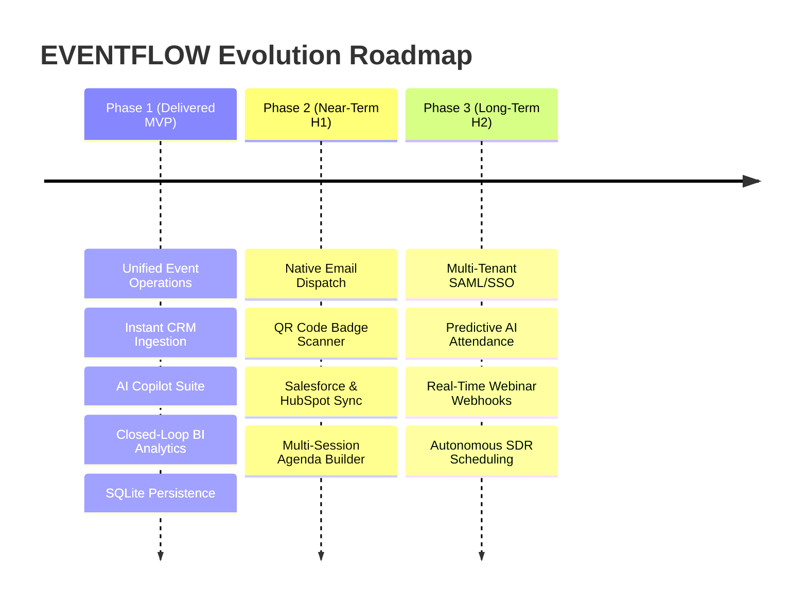

# EVENTFLOW — Product Roadmap & Engineering Horizons

> **Delivered Capabilities, Architectural Constraints, and Strategic Next Steps.**

---

## 1. Product Horizon Overview

---

## 2. Phase 1: Completed Features & Shipped Milestones

### 🏢 Unified Event Operations
- [x] Full event lifecycle CRUD (Draft, Published, Completed, Cancelled).
- [x] Multichannel UTM acquisition tagging (`LinkedIn`, `Partner`, `Email`, `Direct`).
- [x] Real-time capacity monitoring and automated registration limits.
- [x] Dedicated 7-tab Event Workspace (Overview, Registrations, Landing Page, Attendance, Follow-ups, Analytics, Audit Trail).

### 🌐 High-Conversion Registration Engine
- [x] Dedicated public registration route (`/register/[slug]`) with mobile-responsive design.
- [x] Instant client-side and server-side validation.
- [x] Relational duplicate prevention (`@@unique([eventId, contactId])`).
- [x] Seamless attendee-to-CRM ingestion with auto-creation of `Contact` and `Company`.

### 🤝 Embedded B2B CRM & Deal Pipeline
- [x] Contact 360° Profile view with historical event attendance, registration logs, tasks, deals, and activity feed.
- [x] Account directory classified by corporate tier, industry, and aggregate pipeline.
- [x] Interactive Kanban sales pipeline with stage drag-and-drop and probability weighting.
- [x] Task management queue with priority tiers, due date tracking, and status transitions.

### 🤖 Intelligent AI Copilot Engine
- [x] 5 native B2B AI workflows: Event Brief, Follow-up Draft, Meeting Notes, Lead Classification, and Operational Q&A.
- [x] Human-in-the-Loop review and markdown editing before task creation.
- [x] Dual-mode architecture: Google Gemini 1.5 Pro integration with robust deterministic heuristic fallback for offline reliability.
- [x] Complete persistence of AI prompts, token usage, and responses in `AIInteraction`.

### 📊 Closed-Loop Analytics & Executive BI
- [x] 8 real-time KPI cards (Events, Registrations, Attendees, Attendance Rate, Pipeline Value, Won ARR, Qualified Leads, Active Tasks).
- [x] Interactive trend charts and cross-event performance comparisons.
- [x] Channel acquisition breakdown by UTM source.
- [x] Closed-loop 5-stage conversion waterfall (Registered → Confirmed → Attended → Qualified Lead → Won Deal).

---

## 3. Current System Limitations & Boundary Conditions

To maintain focus on core architectural soundness and rapid local execution during Phase 1, the following intentional design constraints exist:

| Area | Current Behavior | Production Recommendation |
| :--- | :--- | :--- |
| **Storage Engine** | Local SQLite (`prisma/dev.db`) | Migrate to PostgreSQL or PlanetScale / Supabase for distributed production scaling. |
| **Email Delivery** | AI generates drafts and scheduled tasks | Integrate transactional email providers (Resend, SendGrid, or AWS SES) for direct one-click email transmission. |
| **Check-in Interface**| Web-based toggle in Event Workspace | Native iOS/Android mobile badge scanner utilizing camera QR decoding. |
| **Session Granularity**| Single event-level registration | Multi-track breakout sessions, keynote capacity caps, and personalized attendee agendas. |
| **Authentication** | Workspace header selection | Enterprise SAML 2.0 / Okta / Azure AD single sign-on with role-based access control (RBAC). |

---

## 4. Phase 2: Near-Term Enhancements (Q1–Q2)

### 2.1 Transactional Email & Messaging Service
- **Provider Integration**: Direct integration with Resend / SendGrid API.
- **Workflow**: One-click dispatch of AI-reviewed follow-up drafts directly from the Contact drawer or Task queue.
- **Delivery Webhooks**: Ingest email opens, link clicks, and bounce events into the attendee's `Activity` timeline.

### 2.2 QR Code Mobile On-Site Badge Scanner
- **Dynamic QR Generation**: Include unique cryptographic registration QR code in confirmation email and Apple Wallet pass.
- **Kiosk Mode**: Progressive Web App (PWA) scanner mode for on-site staff with instant sub-100ms badge check-in and label printing.

### 2.3 Bi-Directional CRM Sync (Salesforce & HubSpot)
- **Two-Way Synchronization**: Map EVENTFLOW events and registrations to Salesforce Campaigns and Campaign Members.
- **Enrichment Engine**: Integrate Clearbit / ZoomInfo / Apollo API to automatically enrich company headcounts, revenue bands, and LinkedIn profiles upon registration.

### 2.4 Multi-Session Agenda Builder
- **Track Management**: Multi-stage agendas with speaker bios, sponsor acknowledgments, and session-level RSVP caps.
- **Attendee Personalization**: Custom itinerary creation with calendar sync (`.ics` export).

---

## 5. Phase 3: Long-Term Enterprise Vision (Q3–Q4)

### 3.1 Predictive AI Attendance & No-Show Modeling
- Train lightweight classification models on historical attendee signals (registration lead time, job title, company tier, past attendance history) to predict day-of attendance likelihood with 85%+ accuracy.
- Dynamically adjust overbooking thresholds per event to ensure 100% capacity fill without walkaways.

### 3.2 Real-Time Virtual & Hybrid Webinar Ingestion
- Native webhooks for Zoom Webinar, Webex, and Microsoft Teams.
- Track real-time engagement minutes, poll responses, and Q&A submissions directly into the attendee's CRM profile.

### 3.3 Autonomous Multi-Agent SDR Scheduling
- Autonomous conversational agent capable of engaging attendees via SMS or email to propose meeting calendar slots based on AE availability.
