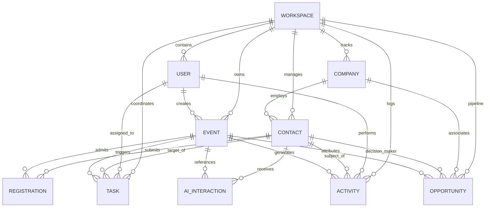
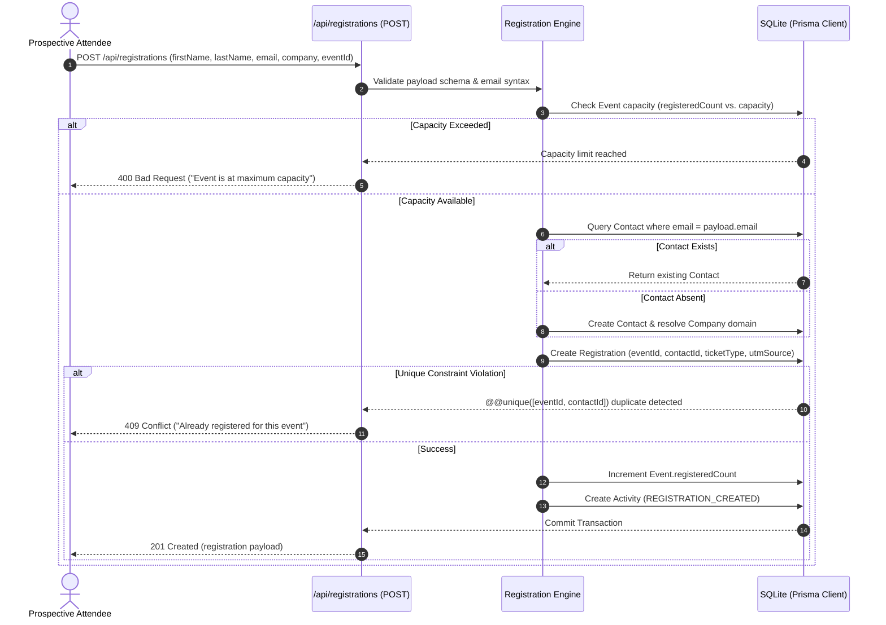
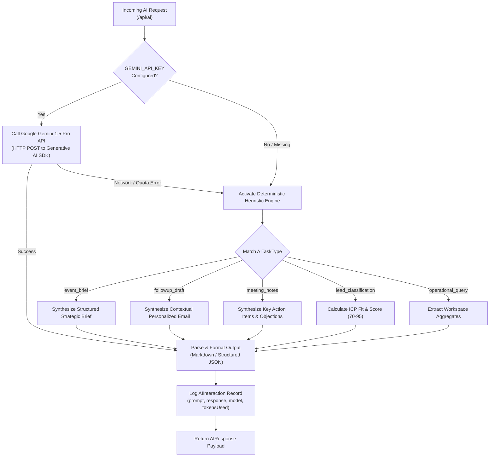

# EVENTFLOW — System Architecture & Technical Specifications

> **Comprehensive Technical Architecture, Component Hierarchies, Data Flow Topologies, and Relational Schema Design.**

---

## 1. High-Level System Architecture

EVENTFLOW is built on an enterprise-grade full-stack architecture utilizing **Next.js 14+ (App Router)**, **TypeScript**, **Tailwind CSS**, **Prisma ORM**, and **SQLite**. The system is decomposed into four clean architectural tiers:

```mermaid
graph TD
    subgraph Presentation_Layer["1. Presentation Tier (Next.js 14 App Router)"]
        UI_Layout["Root Layout & Dark Theme Engine\n(Tailwind CSS, #090D14 Palette)"]
        UI_Dash["Executive BI Dashboard\n(/)"]
        UI_Events["Event Workspace & Details\n(/events, /events/[id])"]
        UI_Reg["Public High-Conversion Portal\n(/register/[slug])"]
        UI_CRM["CRM Directory & Contact 360°\n(/crm, /crm/contacts/[id])"]
        UI_Pipeline["Sales Pipeline Kanban\n(/crm/pipeline)"]
        UI_Tasks["Task & Follow-up Queue\n(/tasks)"]
        UI_Analytics["Closed-Loop Analytics\n(/analytics)"]
        UI_AI["AI Copilot Suite\n(/ai)"]
    end

    subgraph API_Layer["2. API & Route Handler Tier (RESTful JSON Endpoints)"]
        API_Events["/api/events\n/api/events/[id]"]
        API_Reg["/api/registrations\n/api/registrations/[id]"]
        API_Contacts["/api/contacts\n/api/contacts/[id]"]
        API_Companies["/api/companies"]
        API_Opps["/api/opportunities\n/api/opportunities/[id]"]
        API_Tasks["/api/tasks\n/api/tasks/[id]"]
        API_Analytics["/api/analytics"]
        API_AI["/api/ai"]
        API_Seed["/api/seed"]
    end

    subgraph Service_Layer["3. Domain Services & Business Logic"]
        SVC_RegEngine["Registration & Deduplication Engine\n(Capacity Check, Email Matching, Domain Resolver)"]
        SVC_CRM["CRM Account & Pipeline Engine\n(360° History Aggregation, Kanban Moves)"]
        SVC_AI["AI Copilot Service (src/lib/ai-service.ts)\n(Gemini 1.5 Pro + Deterministic Heuristic Fallback)"]
        SVC_Analytics["BI Analytics Aggregator\n(Conversion Funnels, KPIs, Channel Attribution)"]
        SVC_Audit["Activity Audit Logger\n(Immutable Audit Trail)"]
    end

    subgraph Persistence_Layer["4. Data & Persistence Tier"]
        DB_Client["PrismaClient Singleton\n(src/lib/db.ts)"]
        DB_SQLite["SQLite Relational Database\n(prisma/dev.db)"]
        DB_Constraints["Relational Constraints\n(Unique Keys, Foreign Cascade Rules)"]
    end

    Presentation_Layer -->|Fetch / Revalidate| API_Layer
    API_Layer --> Service_Layer
    Service_Layer --> DB_Client
    DB_Client --> DB_SQLite
    DB_SQLite --- DB_Constraints
```

---

## 2. Technology Stack & Design Decisions

| Architectural Layer | Selected Technology | Technical Rationale & Business Justification |
| :--- | :--- | :--- |
| **Framework** | Next.js 14+ (App Router) | Combines performant React Server Components (RSC) with reactive Client Components; unified route handlers for RESTful APIs. |
| **Language** | TypeScript 5 | End-to-end static type safety across database schemas, API contracts, UI props, and domain models. |
| **Styling & Design System**| Tailwind CSS | Apple-inspired dark enterprise palette (`#090D14` canvas, `#131C29` elevated cards, `#3987F5` electric blue primary). Zero CSS runtime overhead. |
| **Data Visualization** | Recharts & Lucide React | Clean, reactive SVG analytical charts (Area, Bar, Funnel, Line) and consistent minimalist enterprise iconography. |
| **Database & ORM** | SQLite & Prisma ORM | Zero-configuration, file-based relational persistence with strict schema enforcement, auto-generated types, and atomic transactions. |
| **AI Copilot Engine** | Dual-Mode Gemini 1.5 Pro + Deterministic Fallback | High-context generative intelligence with 100% offline heuristic fallback for testing resilience and deterministic SLAs. |
| **Testing Harness** | Node.js / `tsx` standalone E2E | 15-step business scenario execution script validating database mutations, edge cases, and API integrity. |

---

## 3. Data Models & Entity Relationship Diagram (ERD)

The database schema models the complete B2B event-to-revenue lifecycle across 9 relational entities:

---

### 3.1 Entity Specifications & Field Dictionary

#### `Workspace`
The root multi-tenant isolation container.
- `id` (String, cuid, Primary Key)
- `name` (String): e.g., "Enterprise GTM Operations"
- `slug` (String, Unique): URL-safe identifier
- `domain` (String, Optional): Primary corporate email domain

#### `User`
System users and staff members.
- `id` (String, cuid, Primary Key)
- `name` (String): Full name
- `email` (String, Unique): Work email
- `role` (String, Default: `ORGANIZER`): `ADMIN`, `ORGANIZER`, `STAFF`, `VIEWER`
- `workspaceId` (String, Foreign Key -> `Workspace.id`)

#### `Event`
Core event record tracking logistics, capacity, and financial ROI.
- `id` (String, cuid, Primary Key)
- `title` (String): e.g., "Business Innovation Forum 2026"
- `slug` (String, Unique): Public URL route parameter
- `description` (String): Full markdown description
- `eventType` (String): `Conference`, `Webinar`, `Workshop`, `Networking`, `Summit`, `Hybrid`
- `status` (String): `Draft`, `Published`, `Completed`, `Cancelled`
- `startDate` / `endDate` (DateTime): Event timing window
- `location` / `venueAddress` (String, Optional): Physical address
- `virtualUrl` (String, Optional): Webinar / stream link
- `capacity` (Int, Default: 100): Seating limit
- `registeredCount` / `attendedCount` (Int, Default: 0): Denormalized counters for fast reads
- `budget` (Float): Total financial budget allocated
- `expectedRevenue` (Float): Target pipeline target
- `workspaceId` (String, Foreign Key -> `Workspace.id`)

#### `Company`
B2B corporate accounts.
- `id` (String, cuid, Primary Key)
- `name` (String): Normalized legal entity name
- `domain` (String, Optional): Corporate web domain (e.g., `novatech.com`)
- `industry` (String, Default: `Technology`): Industry sector
- `size` (String): Employee headcount tier (`1-10`, `11-50`, `51-200`, `201-500`, `500+`)
- `tier` (String, Default: `Mid-Market`): `Enterprise`, `Mid-Market`, `SMB`, `Startup`

#### `Contact`
Prospective buyers and attendees.
- `id` (String, cuid, Primary Key)
- `firstName` / `lastName` (String)
- `email` (String, Unique): Primary identifier for deduplication
- `phone` / `title` (String, Optional): Job title and contact info
- `companyId` (String, Optional, Foreign Key -> `Company.id`)
- `leadScore` (Int, Default: 50): Dynamic ICP score
- `leadStatus` (String, Default: `New`): `New`, `Contacted`, `Qualified`, `Nurturing`, `Customer`, `Inactive`
- `tags` (String, Default: `[]`): JSON string array

#### `Registration`
The join table linking contacts to events with ticketing and UTM parameters.
- `id` (String, cuid, Primary Key)
- `eventId` (String, Foreign Key -> `Event.id`, Cascade Delete)
- `contactId` (String, Foreign Key -> `Contact.id`, Cascade Delete)
- `ticketType` (String): `General`, `VIP`, `Speaker`, `Sponsor`, `Press`
- `status` (String): `Registered`, `Confirmed`, `Attended`, `No-show`, `Cancelled`
- `utmSource` (String, Default: `Direct`): `LinkedIn`, `Email`, `Partner`, `Direct`
- `utmMedium` / `utmCampaign` (String, Optional)
- `checkInTime` (DateTime, Optional): Recorded at physical/virtual check-in
- `notes` (String, Optional): On-site staff interaction notes
- **Unique Constraint**: `@@unique([eventId, contactId])`

#### `Task`
Post-event action items and sales follow-ups.
- `id` (String, cuid, Primary Key)
- `title` (String): e.g., "Post-event follow-up with Elena Rostova"
- `priority` (String): `Low`, `Medium`, `High`, `Urgent`
- `status` (String): `Pending`, `In_Progress`, `Completed`, `Cancelled`
- `dueDate` (DateTime, Optional)
- `contactId` / `eventId` / `assignedToId` (Foreign Keys)

#### `Opportunity` (Deal)
Sales opportunities and pipeline progression.
- `id` (String, cuid, Primary Key)
- `title` (String): e.g., "Novatech Enterprise Platform Expansion"
- `value` (Float): Deal monetary value in EUR
- `stage` (String): `Discovery`, `Qualified`, `Proposal`, `Negotiation`, `Won`, `Lost`
- `probability` (Int, 0–100): Weighted closing probability
- `closeDate` (DateTime, Optional)
- `companyId` / `contactId` / `eventId` (Foreign Keys linking back to event)

#### `Activity`
Immutable event sourcing and activity audit trail.
- `id` (String, cuid, Primary Key)
- `type` (String): `REGISTRATION_CREATED`, `CHECK_IN`, `STATUS_CHANGED`, `OPPORTUNITY_STAGE_CHANGED`, etc.
- `title` / `description` (String): Human-readable event description
- `metadata` (String): JSON payload of event attributes

#### `AIInteraction`
Auditable log of all generative AI prompts and synthesized responses.
- `id` (String, cuid, Primary Key)
- `type` (String): `event_brief`, `followup_draft`, `meeting_notes`, `lead_classification`, `operational_query`
- `prompt` / `response` (String)
- `model` (String): e.g. `gemini-1.5-pro` or `deterministic-fallback`
- `tokensUsed` (Int)

---

## 4. Key Request-Response Lifecycle Workflows

### 4.1 Public Registration & Automatic CRM Resolution Flow

---

### 4.2 AI Copilot & Deterministic Fallback Architecture

To ensure enterprise-grade reliability and zero test flakiness, EVENTFLOW's AI service (`src/lib/ai-service.ts`) implements a robust dual-mode pattern:

---

## 5. Security, Reliability & Performance Architecture

1. **Relational Data Integrity**:
   - SQLite foreign keys enabled with explicit cascade behavior (`onDelete: Cascade` for child registrations and activities; `onDelete: SetNull` for assigned users and opportunities).
   - Atomic multi-model operations executed via Prisma transaction APIs to eliminate partial write state.
2. **Defensive API Validation**:
   - All REST route handlers enforce payload typing, sanitization, and HTTP status codes (`200 OK`, `201 Created`, `400 Bad Request`, `404 Not Found`, `409 Conflict`, `500 Internal Error`).
3. **Responsive Dark UI**:
   - CSS-in-JS overhead eliminated by utilizing Tailwind utility classes compiled at build time.
   - High information density interfaces optimized for enterprise desktop screens (1080p / 1440p) while remaining completely responsive on mobile viewports for public registration and on-site check-in.
4. **Zero-Flake Test Automation**:
   - The dual-mode AI engine ensures that continuous integration pipelines and end-to-end scenarios run deterministically in sub-second execution times without requiring live external network dependencies.
