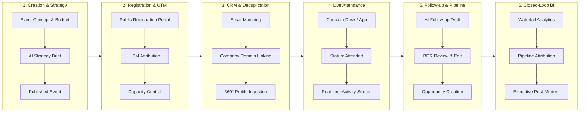
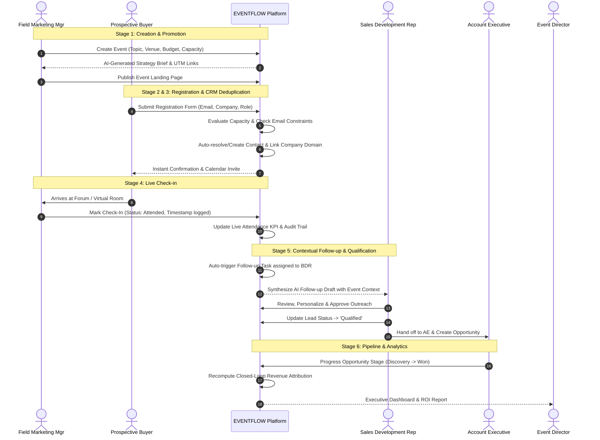
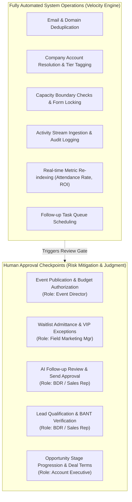

# EVENTFLOW — B2B Event Operations & Event-Led CRM Business Process Specification

> **End-to-End Business Process Architecture, RACI Governance, Automation Boundaries, and Human-in-the-Loop Checkpoints for Event-Led Revenue Operations.**

---

## 1. Executive Summary & Process Philosophy

Modern B2B enterprise marketing allocates between 20% and 25% of annual discretionary budget to field events, conferences, VIP dinners, and executive roundtables. However, traditional event operations treat events as isolated marketing logistics rather than core revenue pipeline drivers.

**EVENTFLOW** establishes an **Event-Led Revenue Engine (ELRE)** that integrates event management directly with enterprise CRM and automated sales development workflows. This specification outlines the operational lifecycle, stakeholder responsibilities, system automation boundaries, and human-in-the-loop governance required to transform event attendance into predictable enterprise pipeline.

---

## 2. Organizational Roles & RACI Governance Matrix

An institutional B2B event requires coordinated execution across Field Marketing, Sales Development, Revenue Operations, and Executive Leadership.

### 2.1 Role Definitions

| Role | Business Title Examples | Primary Objectives | System Access & Actions |
| :--- | :--- | :--- | :--- |
| **Event Director (ED)** | VP Marketing, Head of Events, CMO | Strategic alignment, total budget ROI, brand governance, executive briefing | Full Admin: Workspace creation, budget allocation, final report review |
| **Field Marketing Manager (FMM)** | Field Marketer, Event Manager, Demand Gen Lead | Event planning, logistics, venue coordination, promotional reach, registration pacing | Organizer: Event creation/editing, registration oversight, check-in management |
| **Business Development Rep (BDR)** | SDR, BDR, Inside Sales Rep | Lead qualification, timely post-event outreach, meeting booking | Staff: Contact viewing, task queue execution, AI draft review, lead status update |
| **Account Executive (AE)** | Enterprise AE, Strategic Account Director | Pipeline ownership, enterprise deal progression, contract negotiation | Staff / Organizer: Opportunity management, stage progression, deal closing |
| **Revenue Operations Lead (RevOps)** | RevOps Director, Marketing Ops Manager | Data integrity, CRM schema hygiene, attribution modeling, reporting | Admin: Metric configuration, deduplication audit, attribution analytics |

### 2.2 RACI Matrix by Lifecycle Milestone

* **R (Responsible)**: Executes the activity.
* **A (Accountable)**: Has final decision rights and ownership.
* **C (Consulted)**: Provides two-way input and feedback.
* **I (Informed)**: Kept updated on progress and results.

| Process Milestone | Event Director (ED) | Field Marketing (FMM) | BDR / SDR | Account Exec (AE) | RevOps Lead |
| :--- | :---: | :---: | :---: | :---: | :---: |
| **1. Event Scoping & Budget Approval** | **A** | R | I | C | C |
| **2. AI Strategy Brief & Campaign Setup** | C | **A / R** | I | I | C |
| **3. Landing Page & Registration Launch** | I | **A / R** | I | I | C |
| **4. Account Deduplication & Domain Link** | I | C | I | I | **A / R** |
| **5. Capacity Monitoring & Waitlisting** | I | **A / R** | I | I | I |
| **6. Day-of Check-In & Attendance Logging**| I | **A / R** | C | I | I |
| **7. AI Post-Event Follow-up Drafting** | I | C | **R** | C | **A** (Quality) |
| **8. BDR Outreach Review & Send (<24h)** | I | C | **A / R** | C | I |
| **9. Lead Qualification (ICP Scoring)** | I | C | **A / R** | C | C |
| **10. Sales Opportunity & Pipeline Creation**| I | I | R | **A** | C |
| **11. Closed-Loop BI Attribution & ROI** | **A** | R | I | I | **R** |

---

## 3. Stage-by-Stage Operational Workflow

---

### Stage 1: Event Ideation, Planning & AI Strategy
1. **Business Trigger**: Quarterly demand generation targets or strategic product launch initiatives.
2. **Process Steps**:
   - The Field Marketing Manager (FMM) configures event parameters in EVENTFLOW: Title, Type (Conference, Summit, Webinar, Workshop), Scheduled Dates, Venue/Virtual URL, Seating Capacity, and Budget.
   - FMM triggers the **AI Event Brief Generator**, inputting core themes and target accounts.
   - The AI Copilot returns recommended messaging pillars, target buyer personas (e.g., Enterprise VP Engineering, Head of IT), keynote content outlines, and multi-week promotional schedules.
   - FMM refines details and submits for Event Director approval.
3. **Exit Criteria**: Event status moved from `Draft` to `Published`, generating unique public registration URLs with UTM parameter tracking templates.

---

### Stage 2: Audience Promotion & Registration Acquisition
1. **Business Trigger**: Launch of targeted multichannel promotion (LinkedIn sponsored content, partner co-marketing, executive email invitations, SDR outbound).
2. **Process Steps**:
   - Prospects access the high-conversion, mobile-responsive registration portal (`/register/[slug]`).
   - The registration engine captures: First Name, Last Name, Corporate Email, Job Title, Company Name, and Ticket Type (General, VIP, Speaker, Sponsor).
   - Real-time client and server validation enforces:
     - Strict email syntax verification.
     - Seat inventory check against event capacity.
     - Single registration constraint per event-attendee pair.
3. **Capacity Threshold Protocol**:
   - **80% Capacity**: Automated alert sent to FMM indicating strong promotional traction.
   - **95% Capacity**: Promotional banner displayed on registration portal alerting to limited seats.
   - **100% Capacity**: Registration automatically locks. Subsequent submissions are queued for waitlist approval.

---

### Stage 3: Instant CRM Ingestion & Account Deduplication
1. **Business Trigger**: Incoming HTTP registration payload received by `/api/registrations`.
2. **Process Steps**:
   - **Contact Resolution**: The engine queries the database for existing `Contact` records matching the unique email address.
     - *If match found*: Existing profile is linked; profile data (Job Title, Phone) is enriched without overwriting historical notes.
     - *If match not found*: A new `Contact` record is generated with default `leadStatus = 'New'` and base `leadScore = 50`.
   - **Company Domain Resolution**:
     - The engine extracts the corporate domain from the registrant's email (e.g., `novatech.com` from `elena@novatech.com`).
     - Checks if a `Company` with that domain or normalized name exists. If absent, a new `Company` account is created, pre-tagged with corporate tier and industry.
   - **Relational Integrity**: A unique `Registration` record is created linking `eventId` and `contactId`.
   - **Audit Activity Logged**: An immutable `REGISTRATION_CREATED` entry is appended to the workspace activity timeline.
3. **Exit Criteria**: Zero manual CSV transfers; contact immediately visible on CRM directory and Event Workspace attendees roster.

---

### Stage 4: Day-of Attendance & Real-Time Check-In
1. **Business Trigger**: Registrant arrives at the in-person check-in desk or joins virtual session stream.
2. **Process Steps**:
   - Field marketing staff locates registrant via search filter in `/events/[id]`.
   - Staff updates status from `Registered` or `Confirmed` to `Attended` (or scans badge).
   - The system timestamps `checkInTime = DateTime.now()` and records staff interaction notes (e.g., "Interested in Q3 migration; requested architecture deep dive").
   - Event-level aggregates (`attendedCount`) and overall attendance rates update reactively in SQLite.
   - Unattended registrants are automatically classified as `No-show` following event close.
3. **Exit Criteria**: Attendance roster fully reconciled within 60 minutes of event conclusion.

---

### Stage 5: Contextual Follow-up & Sales Development
1. **Business Trigger**: Event completion or attendee check-in completion.
2. **The 24-Hour Lead SLA**: Sales development research proves that buyer responsiveness drops by 78% after 72 hours. EVENTFLOW enforces an aggressive **<24-Hour First Outreach SLA**.
3. **Process Steps**:
   - **Automated Task Dispatch**: An urgent `Task` is generated in the BDR queue: *"Execute post-event follow-up for [Attendee Name] - [Company Name]"*.
   - **AI Synthesis**: The BDR opens the **AI Copilot Workspace** (`followup_draft` task). The model ingests:
     - Event Title & Topic: *Business Innovation Forum 2026*
     - Attendee Persona: *Dr. Elena Rostova, VP of Engineering, Novatech Solutions*
     - Attendance Status: *Attended, VIP Ticket*
     - Field Notes: *Interested in scalable cloud orchestration & enterprise security*
   - **Human-in-the-Loop Review**:
     - The AI generates a structured, context-rich email draft addressing Elena's specific technical challenges and referencing forum sessions.
     - The BDR reviews the draft, adjusts tone if necessary, and dispatches the outreach.
   - **Pipeline Creation**: Upon prospect engagement, BDR transitions Contact status to `Qualified` and creates a sales `Opportunity` linked to both the corporate account and the originating event.
4. **Exit Criteria**: 100% of attended attendees have an approved, personalized outreach sent within 24 hours.

---

### Stage 6: Closed-Loop BI Analytics & Executive Attribution
1. **Business Trigger**: Scheduled weekly RevOps review or post-event executive debrief.
2. **Process Steps**:
   - Revenue Operations and Event Directors access `/analytics`.
   - The platform calculates closed-loop performance:
     - **Attribution Waterfall**: Registrations → Confirmed → Attended → Qualified Leads → Pipeline Created ($) → Won Deals ($).
     - **Channel Effectiveness**: Comparison of attendee conversion rates across LinkedIn, Partner Co-Marketing, and Direct Invitations.
     - **Cost Per Qualified Lead (CPQL)**: $\text{Event Budget} / \text{Qualified Leads Generated}$.
   - Insights feed into quarterly GTM planning to inform budget allocation for subsequent event cycles.

---

## 4. Automation vs. Human-in-the-Loop (HITL) Checkpoints

To balance operational velocity with enterprise brand protection, EVENTFLOW enforces clear boundaries between automated system tasks and mandatory human approval gates.

### Detailed Automation vs. Human Matrix

| Operational Action | Automation Mode | System Responsibility | Human Owner | Verification / Approval Rule |
| :--- | :---: | :--- | :--- | :--- |
| **Event Strategy Formulation** | **AI Assisted** | Generates messaging pillars, themes, and schedules. | Field Marketing Manager | FMM edits and adapts brief before publishing event. |
| **Registration Ingestion** | **Automated** | Validates email syntax, checks duplicates, commits record. | None (Autonomous) | System blocks double submissions on `@@unique([eventId, contactId])`. |
| **Account Creation** | **Automated** | Normalizes corporate name and domain; attaches to CRM. | RevOps (Audit only) | Auto-matched on email domain; falls back to manual link if generic email. |
| **Capacity Management** | **Automated** | Increments `registeredCount`, evaluates `capacity`. | Field Marketing Manager | Form locks at 100%; FMM can manually expand capacity if venue allows. |
| **Check-in & Status** | **Human Guided** | Records timestamp and shifts attendance metrics. | Staff / FMM | Desk staff explicitly marks check-in to confirm physical/virtual presence. |
| **Follow-up Email Generation** | **AI Assisted** | Ingests role, notes, and session info; constructs personalized draft. | BDR / Sales Rep | **MANDATORY HITL**: System will NOT send unapproved emails. Rep must review. |
| **Lead Qualification** | **Human Owned** | Suggests score based on title/company size. | BDR / SDR | Rep verifies budget, authority, need, and timeline (BANT) before advancing. |
| **Deal Pipeline Entry** | **Human Owned** | Associates deal with originating `eventId`. | Account Executive | AE validates deal value, estimated close date, and target products. |
| **Attribution Rollup** | **Automated** | Aggregates pipeline and closed revenue across all events. | Event Director | Real-time SQL computation; reviewed during executive QBRs. |

---

## 5. Service Level Agreements (SLAs) & Pacing Targets

To prevent pipeline decay, the following operational SLAs are institutionalized:

| Operational Metric | Standard SLA | High-Priority Target | Escalation Trigger |
| :--- | :--- | :--- | :--- |
| **Event Approval to Live Page** | < 24 Hours | < 4 Hours | Unapproved event > 48h escalates to CMO |
| **Registration Ingestion to CRM** | Real-time (< 2 sec) | Instantaneous | Sync error > 30 sec alerts Engineering |
| **Roster Reconciliation Post-Event** | < 4 Hours | < 60 Minutes | Incomplete check-in list at T+12h alerts FMM |
| **First Post-Event BDR Outreach** | < 24 Hours | < 8 Hours | Untouched attendee at T+48h escalates to Sales VP |
| **Qualified Lead Opportunity Creation** | < 72 Hours | < 24 Hours | Stalled qualified lead > 5 days alerts AE Manager |
| **Closed-Loop ROI Reporting** | < 5 Business Days | < 24 Hours | Unreported event budget > 7 days alerts Finance |

---

## 6. Summary

By replacing fragmented spreadsheets and delayed handoffs with EVENTFLOW's cohesive business process architecture, enterprise GTM organizations guarantee:
1. **Zero Lead Decay**: Post-event engagement commences within hours, not weeks.
2. **Uncompromising Data Quality**: Automated domain matching and deduplication preserve pristine CRM hygiene.
3. **Brand Safety**: AI accelerates draft preparation while mandatory Human-in-the-Loop review guarantees enterprise communication standards.
4. **Defensible Attribution**: Every euro of pipeline and closed-won revenue is unambiguously tied back to specific event investments.
