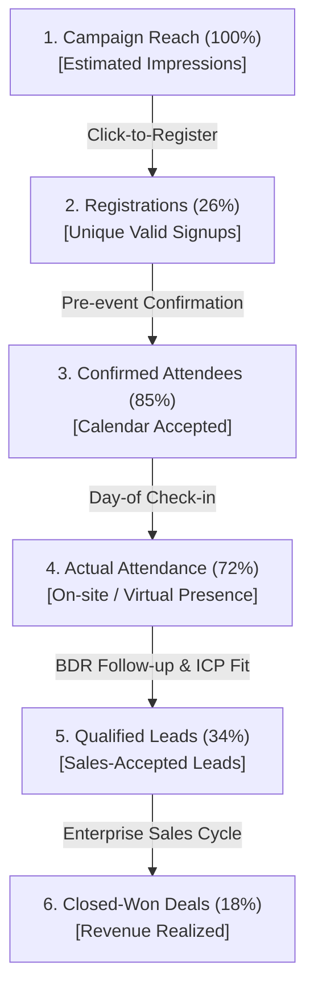

# EVENTFLOW — Metrics Framework, KPI Definitions & Calculation Logic

> **Comprehensive Business Metric Definitions, Mathematical Formulas, Database Query Specifications, and Vanity vs. Value Analysis.**

---

## 1. Executive Summary & Philosophy

In conventional B2B field marketing, event performance reporting is dominated by **vanity metrics**—raw RSVPs, total page visits, or gross registered counts. These numbers create the illusion of marketing traction while obscuring severe pipeline leakage, poor attendance, and zero return on capital.

**EVENTFLOW** implements a **Closed-Loop Event Revenue Intelligence Framework**. Every metric tracked by the platform connects operational execution directly to unit economics and sales pipeline velocity. 

```mermaid
flowchart LR
    subgraph Operational_Metrics["1. Operational Efficiency"]
        M1["Total Registrations"]
        M2["Capacity Utilization %"]
        M3["Attendance Rate %"]
        M4["No-Show Rate %"]
    end

    subgraph Execution_Metrics["2. Execution Velocity"]
        M5["Follow-up Completion Rate %"]
        M6["Average Speed-to-Outreach"]
        M7["Overdue Task Backlog"]
    end

    subgraph Revenue_Attribution["3. Closed-Loop Revenue"]
        M8["Qualified Leads (ICP %)"]
        M9["Cost Per Qualified Lead (CPQL)"]
        M10["Total Pipeline Generated (€)"]
        M11["Closed-Won Revenue (€)"]
    end

    Operational_Metrics --> Execution_Metrics --> Revenue_Attribution
```



---

## 2. Vanity Metrics vs. Actionable Business Metrics

| Vanity Metric (AS-IS Practice) | Why It Is Misleading | Actionable EVENTFLOW Metric | Business Significance & Decision Trigger |
| :--- | :--- | :--- | :--- |
| **Gross RSVPs / Signups** | 40%–60% of free/sponsored RSVPs fail to show up; creates false demand. | **Attended Registrations & Attendance Rate** | Indicates genuine commitment; sizes actual venue requirements. |
| **Registration Cap Reached** | Capacity may be filled with non-ICP or student registrants. | **ICP Target Account Density** | Measures proportion of registrants matching enterprise tier / revenue criteria. |
| **Post-Event Email Blasts Sent** | Mass generic emails trigger unsubscribes without sales pipeline impact. | **Follow-up Completion Rate (<24h SLA)** | Enforces that sales reps have reviewed, personalized, and dispatched outreach within 24 hours. |
| **Gross Marketing Budget Spent** | High expenditure does not correlate with business value. | **Cost Per Qualified Lead (CPQL)** | Directly measures capital efficiency of acquiring sales-ready enterprise leads. |
| **Self-Reported Survey Sentiment** | "Great event" ratings do not pay bills or create pipeline. | **Attributed Pipeline & Won Revenue** | Quantifiable monetary return linked directly to event attendance. |

---

## 3. Core Metric Specifications

### 3.1 Total Registrations
- **Business Definition**: The total number of unique, non-cancelled attendee registrations recorded for an event.
- **Operational Impact**: Primary indicator of promotional reach and top-of-funnel demand generation.
- **Mathematical Formula**:
  $$\text{Total Registrations} = \sum \mathbf{1}_{\{\text{Registration.status} \neq \text{'Cancelled'}\}}$$
- **Prisma DB Computation**:
  ```typescript
  const totalRegistrations = await prisma.registration.count({
    where: {
      eventId: eventId || undefined,
      status: { not: 'Cancelled' },
    },
  });
  ```
- **Edge Cases**:
  - Cancelled registrations are strictly excluded from gross counts to prevent inflated capacity forecasts.
  - Duplicate email submissions are rejected at the database level by unique constraint `@@unique([eventId, contactId])`.

---

### 3.2 Attendance Rate
- **Business Definition**: The percentage of registered attendees who physically checked in or attended the virtual broadcast.
- **Operational Impact**: Evaluates audience commitment, session topic resonance, and the effectiveness of pre-event confirmation reminders.
- **Mathematical Formula**:
  $$\text{Attendance Rate} = \left( \frac{\text{Total Attended Registrations}}{\text{Total Valid Registrations}} \right) \times 100\%$$
- **Prisma DB Computation**:
  ```typescript
  const attendedCount = await prisma.registration.count({
    where: {
      eventId: eventId || undefined,
      status: 'Attended',
    },
  });
  const attendanceRate = totalRegistrations > 0 
    ? Math.round((attendedCount / totalRegistrations) * 100) 
    : 0;
  ```
- **Industry Benchmarks**:
  - In-person executive summits / VIP dinners: **65% – 75%**
  - Paid conferences: **70% – 85%**
  - Free virtual webinars: **35% – 50%**
- **Action Trigger**: If attendance rate falls below 50% for an in-person event, trigger root-cause analysis on reminder cadence and calendar invite delivery.

---

### 3.3 No-Show Rate
- **Business Definition**: The percentage of registered attendees who confirmed or remained registered but failed to attend without prior cancellation.
- **Operational Impact**: Informs food & beverage guarantees, physical room sizing, and identifies disengaged contacts requiring specialized nurture sequences.
- **Mathematical Formula**:
  $$\text{No-Show Rate} = \left( \frac{\text{Total No-Show Registrations}}{\text{Total Valid Registrations}} \right) \times 100\% = 100\% - \text{Attendance Rate} - \text{Cancellation Rate}$$
- **Prisma DB Computation**:
  ```typescript
  const noShowCount = await prisma.registration.count({
    where: {
      eventId: eventId || undefined,
      status: 'No-show',
    },
  });
  const noShowRate = totalRegistrations > 0 
    ? Math.round((noShowCount / totalRegistrations) * 100) 
    : 0;
  ```
- **Operational Workflow**: Registrants remaining in `Registered` or `Confirmed` status 4 hours after event conclusion are transitioned to `No-show` and enrolled in a *"Sorry we missed you"* educational nurture workflow.

---

### 3.4 Capacity Utilization
- **Business Definition**: The proportion of maximum physical or virtual venue capacity occupied by registered attendees.
- **Operational Impact**: Prevents venue fire-code violations and overbooking liabilities while highlighting under-performing campaigns.
- **Mathematical Formula**:
  $$\text{Capacity Utilization} = \left( \frac{\text{Total Registrations}}{\text{Event Max Capacity}} \right) \times 100\%$$
- **Prisma DB Computation**:
  ```typescript
  const event = await prisma.event.findUnique({ where: { id: eventId } });
  const utilization = event && event.capacity > 0
    ? Math.round((event.registeredCount / event.capacity) * 100)
    : 0;
  ```
- **Governance Thresholds**:
  - `< 60%` at T-14 days: Triggers automated promotional escalation to marketing.
  - `>= 95%`: Displays "Limited Seats Remaining" banner on public portal.
  - `= 100%`: Locks registration form, preventing new submissions and enabling waitlist mode.

---

### 3.5 Qualified Leads (Sales-Accepted Attendees)
- **Business Definition**: The number of attendees who meet Ideal Customer Profile (ICP) criteria (seniority, enterprise company size, confirmed pain point) and have been marked as `Qualified` or converted to `Customer`.
- **Operational Impact**: The primary bridge metric between marketing demand generation and sales development pipeline.
- **Mathematical Formula**:
  $$\text{Qualified Leads} = \sum \mathbf{1}_{\{\text{Contact.leadStatus} \in [\text{'Qualified'}, \text{'Customer'}] \land \text{Contact has attended Event}\}}$$
- **Prisma DB Computation**:
  ```typescript
  const qualifiedLeads = await prisma.contact.count({
    where: {
      leadStatus: { in: ['Qualified', 'Customer'] },
      registrations: {
        some: {
          eventId: eventId || undefined,
          status: 'Attended',
        },
      },
    },
  });
  ```
- **Target Ratio**: Greater than **25%** of attendees at targeted B2B executive forums should qualify for active sales follow-up.

---

### 3.6 Follow-up Completion Rate
- **Business Definition**: The percentage of post-event follow-up tasks successfully completed by sales and marketing teams.
- **Operational Impact**: Enforces speed-to-lead and eliminates post-event attendee decay.
- **Mathematical Formula**:
  $$\text{Follow-up Completion Rate} = \left( \frac{\text{Completed Follow-up Tasks}}{\text{Total Assigned Event Follow-up Tasks}} \right) \times 100\%$$
- **Prisma DB Computation**:
  ```typescript
  const tasks = await prisma.task.findMany({
    where: eventId ? { eventId } : undefined,
  });
  const completedTasks = tasks.filter(t => t.status === 'Completed').length;
  const followUpCompletionRate = tasks.length > 0
    ? Math.round((completedTasks / tasks.length) * 100)
    : 0;
  ```
- **SLA Benchmark**: **100% completion within 24 hours** of event conclusion. Tasks remaining incomplete at T+48 hours trigger an automated notification to the Sales Manager.

---

### 3.7 Cost Per Qualified Lead (CPQL)
- **Business Definition**: The total financial expenditure invested in an event divided by the number of sales-qualified leads generated.
- **Operational Impact**: The foundational unit economic efficiency metric for comparing event marketing against digital channels (e.g., Google Ads, LinkedIn Ads, Outbound SDRs).
- **Mathematical Formula**:
  $$\text{CPQL} = \frac{\text{Total Event Allocated Budget}}{\text{Total Qualified Leads Generated}}$$
- **Computation Method**:
  ```typescript
  const event = await prisma.event.findUnique({
    where: { id: eventId },
    include: {
      registrations: {
        where: { status: 'Attended' },
        include: { contact: true },
      },
    },
  });
  const qualifiedCount = event.registrations.filter(
    (r) => r.contact.leadStatus === 'Qualified' || r.contact.leadStatus === 'Customer'
  ).length;
  
  const cpql = qualifiedCount > 0 ? Math.round(event.budget / qualifiedCount) : 0;
  ```
- **Enterprise Benchmarks**:
  - Executive Roundtable / Dinner: **€800 – €1,500** per qualified lead.
  - Tier-1 Flagship Conference: **€1,200 – €2,500** per qualified enterprise lead.
  - Digital Webinar: **€250 – €500** per qualified lead.

---

### 3.8 Pipeline Generated & Closed-Won Revenue Attribution
- **Business Definition**: The total monetary value of sales opportunities (`Opportunity`) created and closed-won (`stage = 'Won'`) that directly originate from event attendees.
- **Operational Impact**: Defensible proof of event ROI presented to the CFO, Chief Revenue Officer, and Board of Directors.
- **Mathematical Formulas**:
  $$\text{Pipeline Generated} = \sum_{\text{opp} \in \text{Opportunities}_{\text{event}}} \text{opp.value}$$
  $$\text{Closed-Won Revenue} = \sum_{\text{opp} \in \text{Opportunities}_{\text{event}}, \text{opp.stage} = \text{'Won'}} \text{opp.value}$$
  $$\text{Event ROI (\%)} = \left( \frac{\text{Closed-Won Revenue} - \text{Event Budget}}{\text{Event Budget}} \right) \times 100\%$$
- **Prisma DB Computation**:
  ```typescript
  const opportunities = await prisma.opportunity.findMany({
    where: eventId ? { eventId } : undefined,
  });
  
  const totalPipelineValue = opportunities.reduce((sum, o) => sum + (o.value || 0), 0);
  const totalWonRevenue = opportunities
    .filter((o) => o.stage === 'Won')
    .reduce((sum, o) => sum + (o.value || 0), 0);
  const eventROI = event.budget > 0 
    ? Math.round(((totalWonRevenue - event.budget) / event.budget) * 100) 
    : 0;
  ```

---

## 4. Full-Funnel Conversion Waterfall Architecture

EVENTFLOW maps every attendee through an unfragmented 6-stage conversion waterfall:



### Waterfall Conversion Formulas

| Transition Stage | Numerator | Denominator | Benchmark Conversion |
| :--- | :--- | :--- | :---: |
| **Reach → Registration** | `Total Registrations` | `Campaign Reach / Impressions` | 2% – 5% |
| **Registration → Confirmed** | `Confirmed Registrations` | `Total Registrations` | 80% – 90% |
| **Confirmed → Attended** | `Attended Registrations` | `Confirmed Registrations` | 70% – 85% |
| **Attended → Qualified Lead** | `Qualified Leads` | `Attended Registrations` | 25% – 40% |
| **Qualified Lead → Closed-Won** | `Won Opportunities` | `Total Opportunities Created` | 15% – 25% |

---

## 5. UTM Channel Attribution & Efficiency

To optimize channel marketing spend, EVENTFLOW segments all registrations by their originating acquisition parameter:
- `LinkedIn`: Paid sponsored posts, executive InMail campaigns.
- `Email`: In-house customer/prospect newsletter and dedicated outbound.
- `Partner`: Co-marketing partner promotions and sponsored affiliations.
- `Direct`: Direct URL visits, personal sales executive invites.

### Attribution Efficiency Calculation
For each channel $k$:
$$\text{Channel Share (\%)} = \left( \frac{\text{Registrations}_k}{\text{Total Registrations}} \right) \times 100\%$$
$$\text{Channel Attendance Conversion (\%)} = \left( \frac{\text{Attended}_k}{\text{Registrations}_k} \right) \times 100\%$$

```typescript
const sourceCountMap = new Map<string, { count: number; attended: number }>();
registrations.forEach((r) => {
  const src = r.utmSource || 'Direct';
  const cur = sourceCountMap.get(src) || { count: 0, attended: 0 };
  cur.count += 1;
  if (r.status === 'Attended') cur.attended += 1;
  sourceCountMap.set(src, cur);
});
```

---

## 6. Summary

By replacing subjective estimates and isolated vanity counts with EVENTFLOW's relational metrics framework, B2B revenue organizations establish complete operational transparency. Every field event is held to rigorous unit economic standards, enabling data-driven budget allocation and predictable pipeline creation.
